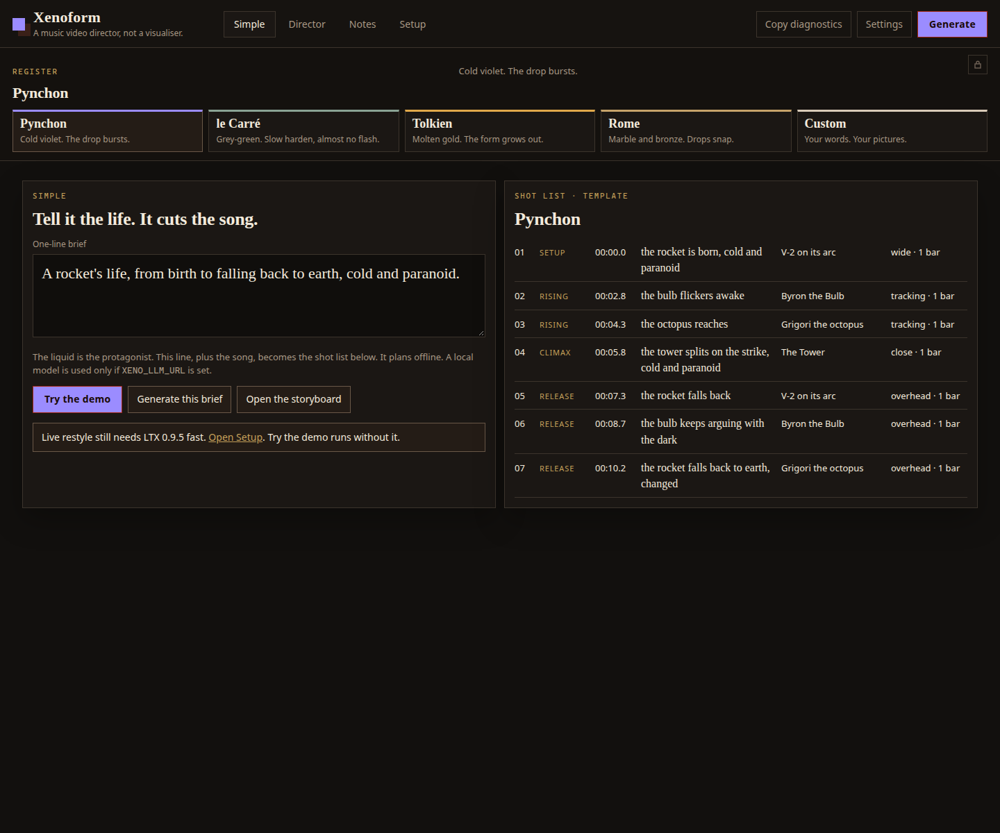
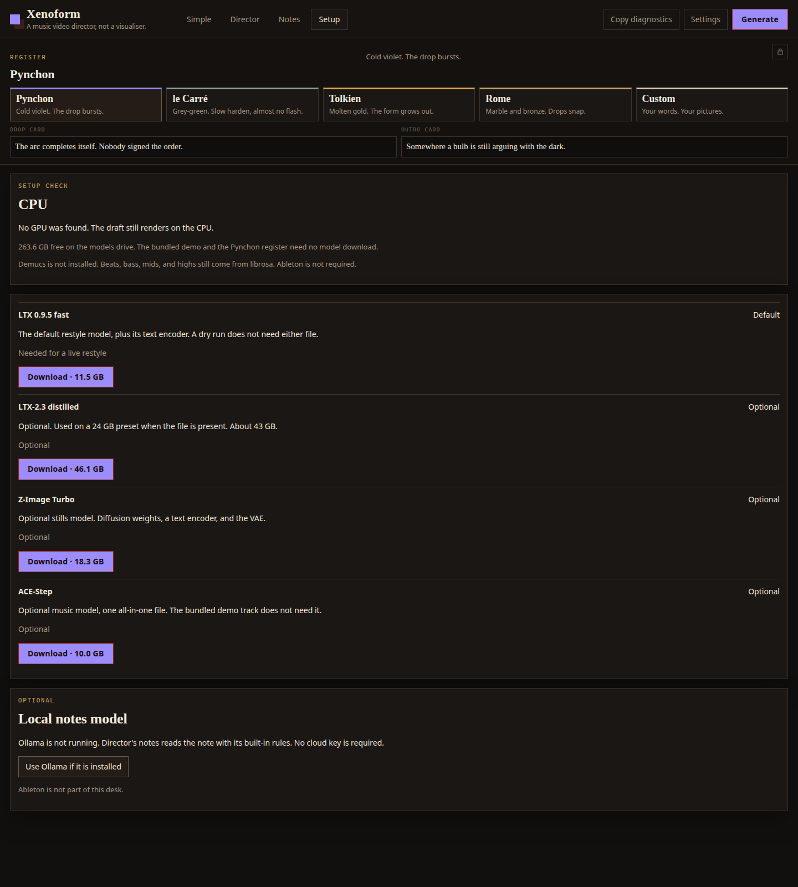

# Xenoform

**Every drop is a transformation.**

Xenoform turns a song into a music video: one object keeps transforming into the next, and every change lands on the beat. Stems drive the light, a MIDI controller rides the picture, and any AI can direct it over MCP.

- **Demo video (under 2:00):** DEMO_VIDEO_URL
- **Repo:** https://github.com/tysonfarrington-cmyk/xenoform
- **100% open weights by default, all local, built on the Comfy SDK.** Every render goes through the official Comfy Python SDK (`comfy-sdk` 0.5.0) and `comfy-api-proxy` in front of your own ComfyUI. Nothing is uploaded and no paid API is called unless you switch one on.
- **Try it with no GPU in 60 seconds:** double-click `Xenoform.bat`, press **Watch a finished one**, then **Bundled demo** and **Make**. The animatic plays in about 3 seconds.
- **Judges:** [docs/REPRODUCE.md](docs/REPRODUCE.md) reproduces the demo in about ten minutes. [docs/CONTEST.md](docs/CONTEST.md) is the submission checklist.

Entry for the [#OpenSourceHiggsfield](https://comfy.org/open-source-higgsfield/) contest, categories **Open Weights Only** and the **LTX bonus**. Code is MIT.

## What it does

Drop in a song and pick a vibe. Xenoform reads the beats, the sections and the drop, plans the cut, shows a draft animatic in about 3 seconds, then renders a chain of LTX morphs on your own GPU (a rose melts into a jellyfish, the jellyfish into a butterfly) with every handoff on the beat. Every video has a recipe code, so anyone with the same song can make the same film or remix it.

It is a music video director, not a visualiser: visualisers pulse to the beat and montage tools cut between unrelated clips. Here the song decides what the subject becomes.

### Simple mode: three decisions

Simple mode is a song, a vibe and **Make**. Under the vibes sit four knobs (**Intensity** for the beat pulse and flash, **Speed** for the cut density and trail length, **Chaos** for the punches, stutters and how far the subject swings, **Glow** for the bloom) and the **Look** chips. Everything else sits in a **Fine-tune** drawer and has a sensible default from the house profile (`configs/defaults_demo.json`, the look used in the demo video). The app times the cut to the song, morphs one object into the next on the beat, reacts to the stems and applies the look; the knobs set how hard.

| Decision | Default | Notes |
| --- | --- | --- |
| Song | Bundled demo (`examples/demo.wav`) | Or drop any wav/mp3/mp4. Stems split in the background the moment it loads (Demucs on the CPU, the band split without it), so the first Make reacts to them. |
| Vibe | 12 featured vibes, 29 in the registry | Each vibe has its own stills, look, LTX settings and transitions ([docs/VIBES.md](docs/VIBES.md)). |
| Make | Draft, the whole song | Draft is LTX-Video 0.9.5. A 20 s clip is about a minute on a 12 GB card; a four-minute song is a shot every bar over a loop of up to 30 morphs and takes about 20 minutes. The panel beside Make says the video length, the shot and morph count and the time before you press it. Final is LTX-2.3 22B distilled fp8 plus a 4x upscale, with its own estimate. |

In the Fine-tune drawer: aspect (**9:16** default, 16:9 and 1:1 stay), **Length** (the whole song, or 60, 30 or 15 seconds centred on the drop), energy (Flow or Dense), **Model** (Draft is LTX-Video 0.9.5, Final is LTX-2.3 22B), **GPU** (auto-detected preset, or CPU, 8, 12 or 24 GB), **Renders on** (the ComfyUI address; paid cloud renders stay off unless you switch them on, and they are not open weights), Forms (morph count, Auto or 1 to 40), macro knobs (**Intensity, Speed, Chaos, Glow**), one reaction lane per stem, the Look (`dance_fx` preset or auto), stem orbit on or off, beat FX, the end card, and a MIDI controller panel. The end card burns the recipe code and `github.com/tysonfarrington-cmyk/xenoform` into the last two seconds.

After a render the knobs stay live: turn Intensity, Speed, Chaos or Glow, pick another Look, and **Re-cut** re-composes the same morphs without the GPU in a fraction of the render time. Also **15 s hook**, **Copy recipe code**, **My videos**. Paste a recipe code under *Make my video* to remix someone else's.

### What is new in 0.3.0

- **Stems.** Every loaded song is split in the background by default (Demucs on the CPU, which the installer ships; a librosa band split without it), so the first Make is stem-reactive; the Stem reactions line shows `splitting stems (demucs)… 40 s`, then `4 stems (demucs)`. Up to 32 stems (`POST /api/stems`, `xenoform stems song.wav`), each with a reaction lane; the four macro knobs ride on top. [docs/stems.md](docs/stems.md)
- **Looks (`dance_fx`).** Stem-reactive, subject-safe passes for character and object shots: `warm-leak`, `cool-echo`, `noir-glow`, `bloom-rush`, `negative-rush`, `cyan-flash`. `auto` follows the house profile per shot (cyan-flash intro, cool-echo body, negative-rush into the end card). Colour and light only; nothing warps the subject.
- **Stem orbit.** A rigid, spring-damped camera orbit of the subject: yaw from the bass, kicks from strong drum hits, a little pitch from the rest. Needs OpenCV (installed by default).
- **Premium transitions.** `match-cut`, `flow-carry`, `depth-parallax`, `lens-breath`, `chrome-refract`, `echo-trail`, at most two uses of any type per video; the rest are clean beat cuts. [docs/transitions.md](docs/transitions.md)
- **House profile and render QA.** `demo_house` is the default profile (9:16 at 1080x1920, 24 fps, black grounds, no shimmer, -14 LUFS). `python -m xenoform.media_qa video.mp4` checks loudness, clicks, black and frozen frames, static shots, opening cuts, duration and the transition rules.
- **VJ mode** at `/vj`: live mic or line-in, the loaded song's stems, premium shader transitions, Web MIDI. [docs/vj.md](docs/vj.md)
- **MIDI.** Web MIDI in the browser, plus `xenoform midi list|serve|record` as a Python bridge for Firefox, Safari and renders. Arturia MiniLab 3 profile, learn mode for anything else, recorded takes become per-frame curves. `pip install -e .[midi]`. [docs/midi.md](docs/midi.md)
- **MCP server with 45 tools**, including `set_look`, `list_looks`, `review_render` and `get_qa`. [docs/mcp.md](docs/mcp.md)
- **Moves (beta).** Wan Animate 2 copies a real dancer's motion onto a character still, frame by frame. Open `/moves`.
- **NASA seed clips** (public domain) are fetched on first run, not committed. `XENO_OFFLINE=1` skips the fetch.

The full list is in [CHANGELOG.md](CHANGELOG.md).

## Models and licences

Open weights only, on your own GPU. Checked against each model card or licence text; dates and links are in [docs/LICENCES.md](docs/LICENCES.md). "Open weights" does not mean every licence allows every use.

| Model | Used for | Licence |
| --- | --- | --- |
| LTX-Video 2B 0.9.5 (Lightricks) | Draft morphs (the default), Turbo | Lightricks Open RAIL-M, with use restrictions |
| LTX-2.3 22B distilled fp8 (Lightricks) | Final morphs, action shots, scene morphs | LTX-2 Community License: free commercial use under about US$10M annual revenue |
| Z-Image Turbo (Tongyi-MAI / Alibaba) | The vibe stills | Apache 2.0 |
| Wan Animate 2 (Wan-AI, Comfy-Org repack) | Moves: motion transfer onto a character still | Apache 2.0, with the lightx2v step-distill LoRA (Apache 2.0) |
| Real-ESRGAN x4plus (Xintao Wang) | Final tier upscale | BSD-3-Clause |
| FLUX.2 Klein 4B (Black Forest Labs) | Optional stills and edits | Apache 2.0 (the 9B weights are non-commercial and are not used) |
| ACE-Step 1.5 | Optional local music | MIT |
| `examples/demo.wav` | The bundled demo song | Made by `xenoform synth`; part of this MIT repo |

The song in the contest demo video ("Morph Engine v2") was made by the author on Suno and is not shipped. Use `examples/demo.wav` or your own track.

This entry claims the **LTX bonus**: LTX-2.3 is the core video model for Final, action shots and scene morphs, and LTX-Video 0.9.5 renders every Draft morph. Prompts are encoded locally. No LTX API key is used. CI (`tests/test_eligibility.py`) fails if a default workflow references a partner or API node, fills an LTX API key, or encodes prompts through an API.

<details><summary>Optional paid paths (off by default)</summary>

None of these run unless you turn them on, and the demo, the judges page and Setup never use them.

- **Paid cloud renders (LTX-2.5 partner node).** Settings → "Paid cloud renders", or `XENO_PAID_CLOUD=1`. Only then does Simple mode show *Cloud quality*, which renders with `LtxApi25ImageToVideo` (`workflows/ltx25_partner_flf_api.json`) behind a price card and a confirm click, and labels the result `cloud-rendered`. With it off, `/api/cloud/estimate` answers 403.
- **Comfy Cloud backend.** `comfy.backend: "cloud"` with `COMFY_ORG_API_KEY` runs the same open-weights graphs on Comfy Cloud (`scripts/cloud_smoke.py`, `configs/cloud_models.json`). Partner and API nodes are blocked on that path too.
- **Add-ons switch** (`comfy.addons`, `XENO_ADDONS`): FLUX 3 API, H3 API, partner nodes and cloud LLMs. `Xenoform.bat` sets `XENO_ADDONS=0`.
- **Local LTX-2.5 open weights.** `workflows/ltx25_morph_api.json` is wired and picked automatically when the four LTX-2.5 files are in the models folder (gated Hugging Face repo, LTX-2.x Community License). It is not the default and has not been run on the 12 GB development card.
- **Director's notes LLM.** Ollama at `http://127.0.0.1:11434` when present; a rule reader answers without it. No cloud key.
- The MCP server never spends money unless a call passes `confirm_spend=true`.

</details>

## Quick start

Three steps. The first cut needs no GPU, no model and no account. You need **Python 3.12** and `ffmpeg` on `PATH`.

1. **Get it.** `git clone https://github.com/tysonfarrington-cmyk/xenoform` or unzip it.
2. **Start it.**
   - Windows: double-click `Xenoform.bat`. On the first run it offers to create Xenoform's own `.venv` (about 5 minutes; it never installs into ComfyUI's Python), then opens the desk at http://127.0.0.1:47317.
   - Linux or macOS: `bash install.sh`, then `.venv/bin/python -m xenoform ui`.
3. **Press Watch a finished one**, then **Bundled demo**, a vibe and **Make**. Start ComfyUI on port 8188 first if you want GPU renders.

<details><summary>Install and launcher details</summary>

**Install.** `install.bat` (Windows) or `bash install.sh` creates `.venv` with Python 3.12, installs the pinned `requirements.txt` (`comfy-sdk` 0.5.0, `comfy-api-proxy` 0.1.6, `opencv-python-headless`, librosa, FastAPI), the `xenoform` package itself and Demucs for stem separation (the `stems` extra, with a CPU torch wheel of about 200 MB; `install.bat -NoStems` or `bash install.sh --no-stems` skips it and the desk uses the band split). The installer finds Python 3.12 on `PATH`, through the `py` launcher, or through `uv`. Linking the pack into `ComfyUI/custom_nodes` is optional: `install.ps1 -LinkNodes` or `bash install.sh --link-nodes`; the desk is then also at `http://127.0.0.1:8188/xenoform`.

Extras: `pip install -e .[midi]` (mido, python-rtmidi), `.[stems]` (Demucs; the installers add it by default), `.[agent]` (the MCP SDK; `Xenoform-MCP.bat` installs it on first run), `.[dev]` (pytest), `.[gpu]` (moderngl), `.[osc]`.

**Launcher.** `Xenoform.bat` starts `comfy-api-proxy` on port 8189 in front of ComfyUI if nothing is listening there (log: `xenoform_proxy.log`), starts the desk minimised, waits until it answers, and opens the browser. The first start writes the demo files and takes about 15 seconds. If a desk is already up it opens the browser and appends a line to `xenoform_duplicate.log`. If 47317 or 8189 is taken, set `XENO_PORT` or `XENO_PROXY_PORT` first. When `configs/local.json` exists it is loaded with `--config`.

By hand, on any platform:

```bash
.venv/bin/comfy-api-proxy run --comfyui http://127.0.0.1:8188 --port 8189
.venv/bin/python -m xenoform ui --host 127.0.0.1 --port 47317
```

(On Windows the paths are `.venv\Scripts\comfy-api-proxy.exe` and `.venv\Scripts\python.exe`.)

**Models.** The Setup page in the desk lists each model with its size and a Download button; downloads resume and are checksummed. Required for GPU morphs: LTX-Video 0.9.5 (6.3 GB) and the T5-XXL fp8 encoder (5.2 GB). Optional: LTX-2.3 distilled fp8 for Final (put `ltx-2.3-22b-distilled-fp8.safetensors` and `ltx-2.3-spatial-upscaler-x2-1.1.safetensors` in `models/checkpoints` and `models/latent_upscale_models`, with the Gemma 3 12B text encoder), Z-Image Turbo (18 GB in three files) to make new vibe stills, Real-ESRGAN x4plus for the Final upscale, Wan Animate 2 for Moves (Comfy-Org `Wan2.2-Animate-2` repack: int8 model, lightx2v LoRA, UMT5-XXL fp8, CLIP vision H, Wan 2.1 VAE). ComfyUI 0.33 or newer has every node the shipped graphs use.

</details>





### How a render runs

Make reads the song's sections and gives each a role: the intro and the verses breathe (two bars a shot, morphs in real time, no tricks), builds and choruses drive (a bar a shot, light punches on the downbeats), the drop punches and cuts on the half bar for eight bars, the outro eases out, and every section switch gets the vibe's own premium transition (never more than two of a kind). It first cuts the vibe's stills to that plan and plays it within seconds: the skeleton of the cut, on the beat, with the song. The GPU pass then renders the morphs through comfy-sdk → comfy-api-proxy → ComfyUI. For a clip under 45 s that is one morph per shot: morph *i* starts on still *i* and ends on still *i+1*, so the picture never jumps. For a full song the cut keeps a shot every bar (every half bar after the drop) and renders a closed loop of 12 to 30 four-second morphs instead, one unique morph per ten seconds of song; the shots walk the loop in order, so every handoff is still one continuous transformation and the chain simply comes round again, as a chorus does. On 9:16 the stills are re-laid whole on black and the Draft morphs render in portrait (320x576), so a ribbon or a helix is never clipped by a crop. Each shot is then retimed to its slot (speed, punches, holds, stutters), given the beat FX and the Look (on Auto the look's colours are taken from the vibe's own stills, so a cobalt vibe stays cobalt and a gold one stays gold instead of wearing a fixed blue cast), orbited by the stems, and muxed with the song; Draft composes at 540x960 so the look pass stays quick. If the GPU pass fails, the stills cut stays as the result.

```mermaid
flowchart LR
  A[Song] --> B[Analyse: beats, sections, drop, stems]
  B --> C[Cut plan on the beat grid]
  C --> D[Vibe stills, 12 per vibe]
  D --> E[Comfy SDK → comfy-api-proxy → ComfyUI: LTX morphs]
  E --> F[dance_fx look + stem_orbit + transitions_fx]
  F --> G[Mux, end card, media_qa]
  B --> H[/vj live page, MIDI, OSC]
```

The SDK calls are the documented ones: `workflows.from_file`, `assets.from_file`, `set_input`, `submit(idempotency_key=...)`, `events`, `result`, `get_outputs`. `COMFY_BASE_URL` is set from `comfy.proxy_url`; a local proxy never receives an API key. Stock ComfyUI without the proxy is also handled: the desk falls back to `POST /upload/image` and `POST /prompt` on port 8188.

`workflows/xenoform_morph.json` is the plain API-format A→B morph (LTX 0.9.5, two `LTXVAddGuide` frames). Put two stills named `shot-a.png` and `shot-b.png` in `ComfyUI/input` and queue it in ComfyUI directly if you want to see the graph on the canvas. `workflows/xenoform_draft.png` carries the same graph in its PNG `workflow` chunk.

### Vibes and stills

The stills live in `src/xenoform/ui_static/objects/<vibe>/`, twelve per vibe, generated locally with Z-Image Turbo (`scripts/vibe_objects/`). A run walks the list forward and only wraps after twelve shots, and when the pool would wrap it uses fewer, longer morphs instead of repeating. Each vibe's default clip pack (`ui_static/library/<vibe>/`) is cut from a hand-checked LTX 0.9.5 morph; `configs/clip_pack.json` records the scores. Per-vibe LTX settings come from an overnight auto-tuner ([docs/AUTOTUNE.md](docs/AUTOTUNE.md)). Real subjects (Jupiter, Saturn, Earth, Moon, Mars) use public-domain NASA photographs as anchors instead of painted stills.

### Guardrails

Every render (desk, MCP, CLI) first passes through `configs/guardrails.json`, which clamps settings known to produce flaky output and reports what it changed on the job: about 15 forms per 20 s, no stutter inside morph runs, black morph grounds, no shimmer, the Gemma encoder on LTX-2.x, 12 GB VRAM limits, at most two of any transition type, no partner nodes in open-weights mode. `xenoform guardrails` prints them. Expert mode keeps your values and only warns.

## Hardware

The desk reads the GPU and picks a preset. If a render runs out of memory it drops a tier, retries, and says so in plain words.

| Machine | Draft | Final | Weights |
| --- | --- | --- | --- |
| No GPU | Animatic only, dry run | Dry run | None |
| About 8 GB | LTX 0.9.5 at 512×288 | Falls back to Draft | LTX 0.9.5, offloaded |
| About 12 GB (the development card, an RTX 3080 Ti) | LTX 0.9.5 at 512×288, about a minute for 7 morphs warm | LTX-2.3 fp8 two-stage at 448×768 native 9:16, Real-ESRGAN to 1080×1920, about 90 to 240 s a shot, peak about 11.9 GB | LTX 0.9.5 plus LTX-2.3 fp8 |
| 24 GB and up | LTX 0.9.5 or LTX-2.3 | LTX-2.3 at 768×448 or native 9:16 | Full distilled weights fit |

Moves (Wan Animate 2) runs at 480×832, 81 frames, about 11.6 GB peak. The VJ page runs in WebGL and never loads a weight.

## Troubleshooting

| What you see | What to do |
| --- | --- |
| The installer says Python 3.12 was not found | Install Python 3.12 from python.org and tick "Add python.exe to PATH", then open a new window. |
| Make sits on "Reading the track" | `ffmpeg` needs to be on `PATH`. |
| The desk says ComfyUI is not connected | Start ComfyUI on port 8188. Dry runs and the animatic work without it. |
| Live renders cannot reach the proxy | Check `xenoform_proxy.log`. The launcher only starts `comfy-api-proxy` when nothing listens on 8189; `set XENO_PROXY_PORT=8190` moves it. |
| Port 47317 is in use | `set XENO_PORT=47322`, then `Xenoform.bat`. The MCP server follows `XENO_DESK`. |
| A download stops | Press the same Download button; it resumes. A file that fails its checksum is deleted and the page says to run it again. |
| The GPU ran out of memory | Leave the message up; the desk already dropped a tier and retried. Close other GPU programs if the 8 GB preset also fails. |
| Stem orbit did nothing | OpenCV is missing. `pip install opencv-python-headless` into `.venv`; the job's `look.notes` say so. |
| No MIDI in Firefox or Safari | Run `xenoform midi serve`; the page then shows `MIDI: bridge`. |
| Copy diagnostics | The header button copies a short report. |

## Drive it from any AI (MCP)

The desk is also an MCP server. Claude Desktop, Claude Code, Cursor or any MCP client can pick vibes, set the look, render, poll, cancel, list videos, share recipe codes, review a finished file and re-cut like an editor. It binds to localhost only, has no token, never returns secrets, and never spends money unless a call passes `confirm_spend=true`. Keep the desk running, then:

```bat
Xenoform-MCP.bat              :: stdio, for Claude Desktop and Cursor
Xenoform-MCP.bat --http       :: http://127.0.0.1:47319/mcp, localhost only
claude mcp add xenoform --env XENO_DESK=http://127.0.0.1:47317 -- .venv\Scripts\python.exe -m xenoform.mcp
```

Claude Desktop (`%APPDATA%\Claude\claude_desktop_config.json`) or Cursor (`.cursor/mcp.json`):

```json
{
  "mcpServers": {
    "xenoform": {
      "command": ".venv/Scripts/python.exe",
      "args": ["-m", "xenoform.mcp"],
      "env": { "XENO_DESK": "http://127.0.0.1:47317" }
    }
  }
}
```

Use the absolute path of the checkout's `.venv` Python on your machine (`.venv/bin/python` on Linux and macOS). The 45 tools, the prompts and the resources are listed in [docs/mcp.md](docs/mcp.md); the AI's own guide is [docs/AI_GUIDE.md](docs/AI_GUIDE.md).

## Command line

```bash
xenoform ui                                  # the desk on 47317
xenoform stems song.wav --engine auto        # split stems (demucs when installed, else bands)
xenoform midi list | serve | record take.json --seconds 90
xenoform mcp [--http --port 47319]           # MCP server
xenoform guardrails                          # print the clamps
python -m xenoform.media_qa video.mp4        # render QA report
python -m xenoform.scene_edit spec.json      # cut your own footage to the beat (docs/footage.md)
xenoform osc examples/demo_features.json --stream --port 7000   # OSC clock for TouchDesigner
xenoform run --config configs/example.json --synth --out work/xenoform.mp4   # the stage pipeline, dry run
pytest                                       # the test suite
```

## Advanced desk

The *Advanced* button in the header keeps the full director desk: a storyboard with one action shot per section, literary registers for the treatment, Director's notes (one plain-English note becomes a checked JSON patch), Review & fix (a rule-based critic that measures the cut and re-renders only the shots that drift), versions, and OSC and CSV export for TouchDesigner. Simple mode does not need any of it. The REST API the browser and the MCP server share is under `/api/v1/` (health, session, registers, storyboard, params, notes, review, render, frames, versions, export).

Related pages: [docs/footage.md](docs/footage.md) (your own clips, the NASA library, camera roll), [docs/transitions.md](docs/transitions.md), [docs/VIBES.md](docs/VIBES.md), [docs/AUTOTUNE.md](docs/AUTOTUNE.md), [docs/LESSONS.md](docs/LESSONS.md), [docs/SURPRISE.md](docs/SURPRISE.md).

## Layout

```
Xenoform.bat, Xenoform-MCP.bat         Windows launchers (desk, MCP server)
install.bat, install.ps1, install.sh   create .venv with Python 3.12 and install the package
pyproject.toml, requirements.txt       pinned dependencies (comfy-sdk 0.5.0, comfy-api-proxy 0.1.6)
__init__.py, web/                      optional ComfyUI node pack entry (Try It, Setup Check)
src/xenoform/
  ui.py, ui_static/                    the desk: Simple mode, /vj, /moves, /judges, /licences, /credits
  dense.py, morph_pass.py, final_tier.py, portrait.py   cut plan, morph chain, Draft and Final tiers
  dance_fx.py, stem_orbit.py, transitions_fx.py, beatfx.py   looks, orbit, transitions, beat FX, end card
  stem_react.py, stems_api.py, stems.py, midi_bridge.py   stems and MIDI
  mcp_server.py, mcp_tools.py          MCP server (45 tools)
  media_qa.py, post_qa.py, shot_qa.py, guardrails.py, demo_house.py   QA and the house profile
  restyle.py, cloud_backend.py, cloud_morph.py, eligibility.py   SDK runner, optional cloud, open-weights audit
configs/                               vibes.json, autotune.json, guardrails.json, defaults_demo.json,
                                       transitions.json, clip_pack.json, anchors.json, moves.json, example.json
workflows/                             xenoform_morph.json (LTX 0.9.5), xenoform_draft/final, moves_wan_animate2.json,
                                       ltx_v2v*.json, ltx25_*.json (optional, not default)
assets/library/                        manifest.json and the NASA anchor stills; clips are fetched on first run
library/                               shapes, loops, moves (driving clips are fetched, not shipped)
examples/                              demo.wav, demo_base.mp4, demo_features.json
scripts/                               vibe_objects/, autotune/, fetch_library.py, fetch_moves.py, build_showcase.py, qa_library.py
docs/                                  REPRODUCE, CONTEST, LICENCES, mcp, stems, midi, vj, VIBES, transitions, footage, demo/
tests/                                 pytest suite, incl. test_eligibility.py and test_docs.py
```

## Licence

MIT. See [LICENSE](LICENSE). Model weights, the two desk fonts (SIL OFL) and the pictures are not covered by that grant; see [docs/LICENCES.md](docs/LICENCES.md) (served at `/licences`) and [CREDITS.md](CREDITS.md) (served at `/credits`).
