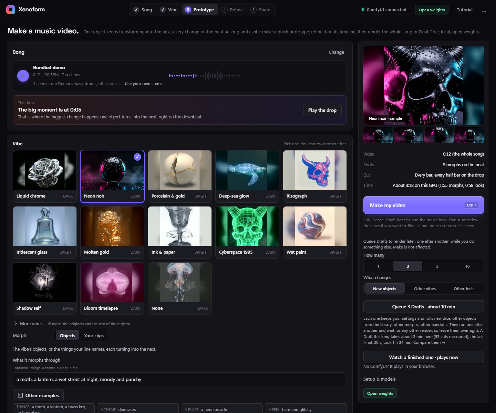
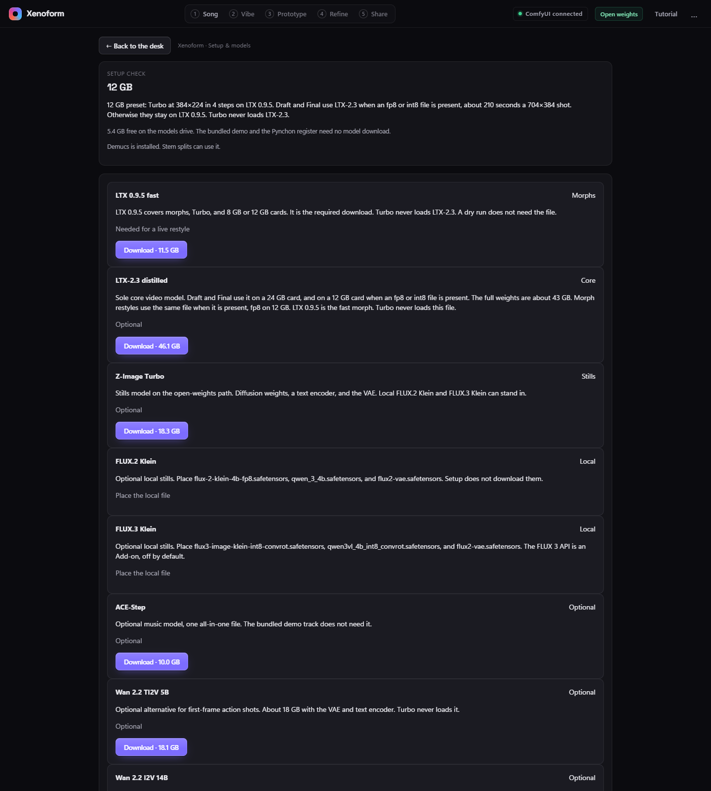

# Xenoform

**Every drop is a transformation.**

Xenoform turns a song into a music video: one object keeps transforming into the next, and every change lands on the beat. Stems drive the light, a MIDI controller rides the picture, and any AI can direct it over MCP.

- **Demo video (under 2:00):** https://youtu.be/x_zMu29HfDA
- **Full walkthrough (8 min):** https://youtu.be/xpUb5XcHtlQ
- **Repo:** https://github.com/tysonfarrington-cmyk/xenoform
- **100% open weights by default, all local, built on the Comfy SDK.** Every render goes through the official Comfy Python SDK (`comfy-sdk` 0.5.0) and `comfy-api-proxy` in front of your own ComfyUI. Nothing is uploaded and no paid API is called unless you switch one on.
- **Try it with no GPU in 60 seconds:** double-click `Xenoform.bat`, press **Watch a finished one**, then **Bundled demo** and **Make**. The animatic plays in about 3 seconds.
- **Judges:** [docs/REPRODUCE.md](docs/REPRODUCE.md) reproduces the demo in about ten minutes. [docs/CONTEST.md](docs/CONTEST.md) is the submission checklist.

Entry for the [#OpenSourceHiggsfield](https://comfy.org/open-source-higgsfield/) contest, categories **Open Weights Only** and the **LTX bonus**. Code is MIT.

## What it does

Drop in a song and pick a vibe. Xenoform reads the beats, the sections and the drop, plans the cut, shows a draft animatic in about 3 seconds, then renders a chain of LTX morphs on your own GPU (a rose melts into a jellyfish, the jellyfish into a butterfly) with every handoff on the beat. Every video has a recipe code, so anyone with the same song can make the same film or remix it.

It is a music video director, not a visualiser: visualisers pulse to the beat and montage tools cut between unrelated clips. Here the song decides what the subject becomes.

### One desk: Song, Vibe, Prototype, Refine, Share

The desk is one flow, shown as a strip on every screen. A song and a vibe make a quick **prototype**; its own screen is where you **refine** it (the timeline, the knobs, a re-cut without the GPU) and **render** it whole or at Final, then **share** it. There is no second desk: the old Advanced (Director tools) desk drove a storyboard path the cuts never used, and it was folded away on 26 Oct 2026 ([docs/WORKFLOW_AUDIT.md](docs/WORKFLOW_AUDIT.md)).

The first screen is a song, a vibe and **Make**. Under the vibes sit four knobs (**Intensity** for the beat pulse and flash, **Speed** for the cut density and trail length, **Chaos** for the punches, stutters and how far the subject swings, **Glow** for the bloom), the **Morph** chips (how each object becomes the next: **Melt**, the liquid flow; **Shatter** into shards that snap together; **Bloom**, opening like a flower; **Spin**, turning as it changes; **Fold**, like paper; **Auto** melts through the verses, shatters on the drop and, by the Chaos knob, blooms the opening or folds the builds and spins after the drop; `xenoform.morph_style`), the **Timing** chips (when the change happens inside each morph: **Smooth**, as the model made it; **On the beat**, in steps that land on every beat inside the shot; **Snap**, a hold and then the whole change in about a beat on the downbeat, hardest on the drop; it re-times the cached clips from their measured change, so the cut's screen re-cuts it with no GPU; `xenoform.morph_timing`), the **Effects** chips (TouchDesigner-style, any together, riding the kick and the loudness, a re-cut with no GPU: **Dither hits** drop the picture to a few tones of the cut's own palette in fine blue-noise dots on each kick, **Feedback** leaves a zooming tunnel of each bright object, **Kaleido** folds the frame into turning mirrored wedges, **Slit-scan** bends motion by taking each row from a moment further back, and **Blocky smear** lets the datamosh smear back in at one handoff in six at most, off by default; `xenoform.effects`) and the **Look** chips (the dance presets, and **Dither**: the whole cut in the palette's tones and blue-noise dots, a new grain on each beat). Everything else sits in a **Fine-tune** drawer and has a sensible default from the house profile (`configs/defaults_demo.json`, the look used in the demo video). The app times the cut to the song, morphs one object into the next on the beat, reacts to the stems and applies the look; the knobs set how hard.

| Decision | Default | Notes |
| --- | --- | --- |
| Song | Bundled demo (`examples/demo.wav`), or one of the six bundled songs | The bundled songs are the author's own Suno instrumentals in `examples/songs/`, a chip each under Choose a song, shipped with their analyses so one loads at once: Morphing Wobble (a 20 s cut and the whole song), Hip hop, boom bap, Liquid drum and bass, Ambient and Glitch Out. Or drop any wav/mp3/mp4. Stems split in the background the moment it loads (Demucs on the CPU, the band split without it), so the first Make reacts to them; the Stems line under the song shows the split, and **Use your own stems** on that line takes a DAW or Suno export instead. |
| Vibe | 11 featured vibes and None, 30 in the registry | Each vibe has its own stills, look, LTX settings and transitions ([docs/VIBES.md](docs/VIBES.md)). |
| Make | Draft; a song over 45 s is prototyped as 30 s around the drop | The first Make of a long song is a quick prototype (Fine-tune → Length keeps the choice once you pick one); the cut's screen then has **Render the whole song** and **Render at Final**. Draft is LTX-Video 0.9.5. A 20 s clip is about a minute on a 12 GB card; a four-minute song is two bars a shot (a bar on the drop), one morph per shot and no object twice, and takes about 20 minutes. Draft affords 48 morphs, Final 12 and Cloud Final 16; past that the song is re-planned with fewer, longer shots. The panel beside Make says the video length, the shot and morph count and the time before you press it. Final is LTX-2.5 when its files are installed and LTX-2.3 22B distilled fp8 plus a 4x upscale otherwise, with its own estimate. |

In the Fine-tune drawer: aspect (**9:16** default, 16:9 and 1:1 stay), **Length** (the whole song, or 60, 30 or 15 seconds centred on the drop), energy (Flow or Dense), **Model** (Draft is LTX-Video 0.9.5, Fast Final is the Draft upscaled, Final is LTX-2.5 22B when its four files are installed and LTX-2.3 otherwise, Cloud Final is LTX-2.5 on Comfy Cloud), **GPU** (auto-detected preset, or CPU, 8, 12 or 24 GB), **Renders on** (the ComfyUI address; paid cloud renders stay off unless you switch them on, and they are not open weights), Forms (morph count, Auto or 1 to 40), stem orbit on or off, beat FX, the end card and **Your images** (a folder on your machine, or images dropped on the row: they lead the morph chain as morph targets). Under the knobs, beside the Morph chips, sit **Stem reactions** (one lane per stem), the Look (`dance_fx` preset or auto) and **Foreshadow** (the next object traced, negative, sliced or silhouetted into the tail of the shot before it, riding the song's other stem; Auto picks by the vibe). The end card burns the recipe code and `github.com/tysonfarrington-cmyk/xenoform` into the last two seconds.

**Work in progress** (the drawer under Fine-tune, closed by default): Xenoform is the morph engine, and what is on the desk but is not the engine waits here until it is finished ([docs/MORPH_ENGINE_PLAN.md](docs/MORPH_ENGINE_PLAN.md)). Each works as it did: **Performer** (Polly, below; the idea line no longer switches her on), **Paid cloud**, **Moves**, **VJ mode** and the MIDI controller, and **Connect an AI**.

**Performer shots** (Work in progress → Performer, off by default): MiniMax H3, an open-weights audio-to-video model that runs on your GPU through the same Comfy SDK path, has Polly (the bundled fictional character, posed at the kit, the microphone, the keys, with a guitar and dancing, or your own full-body still) perform the song itself: she sings where the vocal stem sings (lip-synced to the vocal), drums on the first drop, dances on the other loud passages and plays keys, then dances, then guitar on the quiet ones, or whatever the Performance chips say (sing, drums, keys, guitar, dance), in two or four slots cut 1:1 into the morph chain. Each shot opens on the still posed for that performance; the song is fed two seconds early and the clip starts where the performance has begun (past a held, dissolving or hard-cut still, measured frame by frame), and a shot that would still leak the still is re-rolled once. A 5 s shot is about eight minutes on a 12 GB card (the turbo LoRA does not help when the 19 GB model streams from RAM); the panel beside Make adds it to the estimate. LTX-Video stays the core morph model. Licence: the MiniMax H3 Community License (open weights; see docs/LICENCES.md). See [docs/performer.md](docs/performer.md).

**Your idea in one line** (the field under the vibes) shapes the cut. "girl dancing to rave music in a cyberpunk city outside a warehouse, lasers" is read (`xenoform.idea`, rules, no model; `XENO_LLM_URL` lets the local model refine it) as a scene to morph through (the place and its light: "a cyberpunk city outside a warehouse with lasers", rendered as wide frames before Make and Scenes set to Mix if you left it Off), the objects the library knows (a moth opens the cut and its family fills the chain) and the things it lacks (a laser, rendered as your own shape, first in the chain); a dancer or singer sets Polly's performance when she is switched on in Work in progress. What the line was read as shows under it as you type, as labelled chips rather than prose: a row for what the morphs travel through, one for the places they pass through, one for how it feels (with the knobs and Look it moved) and one for a performer, with "new" on what Make draws first and a count of the stills it will render; with the line empty the same rows show dashed examples, and the long explanation is folded behind "How the line works" (`POST /api/simple/idea`; the making screen keeps the one-line summary, "Scenes: … Objects: … Polly: dancing (in Work in progress)."). The record keeps the reading, and the Scenes row still has the last word (it shows Mix when the line turned scenes on; Off picked by hand stays Off). The line names things to morph between, not a story. A theme word brings fifteen things of its own (`idea.THEMES`, about thirty themes: underwater, magic, dinosaurs, space, halloween, samurai, the wild west…): "underwater" brings a jellyfish, an octopus, a seahorse, a nautilus, a manta ray and ten more sea creatures, Make draws the ones the library lacks first, and the chips say "the underwater theme"; "a jellyfish" is still just the jellyfish.

**The chain is yours to choose** (Fine-tune → Chain): the row shows the stills this Make will morph through, in order, the way the draft previews them (`POST /api/simple/chain`, nothing rendered). Click a slot and pick another object or scene from the vibe's library; a pinned slot holds through Make (the make body's `chain_pins`, which the pick honours slot by slot and fills the rest around, no still twice), the other slots are picked fresh each time, and the record says which slots were pinned.

After a render the knobs stay live: turn Intensity, Speed, Chaos or Glow, pick another Look, and **Re-cut** re-composes the same morphs without the GPU in a fraction of the render time. On the timeline **Dream here** re-dreams 1 to 3 s from a shot through Z-Image Turbo img2img, every other frame (12 a second, each held and blended into the next), light or deep, cut in like a generated run: the objects keep their places while their surfaces and meanings drift, the nearest thing to StreamDiffusion this machine has (about 2.6 s of GPU a dreamed frame, so two seconds is about a minute and a half with the model load; `xenoform.dream`, `POST /api/jobs/{id}/dream`). A shot's **Timing** chips give it its own timing (Apply re-cuts it, no GPU), and its **Morph** chips re-render just that morph in another style (one Draft morph, then the re-cut; the tile names any style that is not a Melt), and **Render at Final** keeps each shot's style. On the shots lane under the player, **Swap an object** replaces the still a shot lands on: only the two morphs that touch it are rendered again (Draft: two morphs' worth of the cut's render time, about 40 s on a 12 GB card, plus the re-cut), the rest of the cut is kept and re-composed (`POST /api/jobs/{id}/swap`; the record logs the swap). Under the timeline the **Share** row has **Share cut** (a 720p H.264 under 16 MB for a post), **15 s hook**, **Edit in Resolve** (the cut as an editor's timeline for DaVinci Resolve, Premiere or Final Cut: a file a shot on V1 named for its objects, the song on A1, markers at the drop and the dressed handoffs, as FCP7 XML, FCPXML and an EDL zipped with the media; `POST /api/videos/{id}/edit`, `xenoform.edit_export`), **Copy recipe code** and the cut's **Shot list** and **Seed file**; **Download** in the head is the file at the size it was rendered. Under Make, **Variations** queues 1, 3, 5 or 10 Drafts of the same song and line, varying the seed, the vibe or the feel ("slow and dreamy", "hard and glitchy"); they run one after another, each waiting until no other cut is rendering and ComfyUI's queue is empty, so a batch can run overnight, and land side by side on `/variations` with their posters, their measured times and **Render this one at Final** (`POST /api/batches`, `xenoform.batch`). Every cut lands in **My videos**. Paste a recipe code in Fine-tune to remix someone else's.

The lane is a **Timeline** ([docs/TIMELINE.md](docs/TIMELINE.md)): each tile is the cut's own frame at that shot. Click a shot and its drawer opens in four tabs. **Shot**: hold it or let it morph, move its morph left or right, duplicate it into the next slot, delete it (the shot before plays on), its Timing. **Look**: its own Look, Colour (hue, saturation, brightness, contrast, warmth), Effects and beat-FX intensity. **Join**: the seam into it as a Flow or a Cut, moved a beat or half a beat, dressed with a transition (a click on a seam opens this tab). **Regenerate**: its morph style, swap the object it lands on, re-render the morph (`POST /api/jobs/{id}/rerender`), **Generate here** (`POST /api/jobs/{id}/insert`) or **Dream here**. Every edit, and every knob you turn, waits in one bar at the bottom of the window: **Apply** re-cuts from the cached morphs, no GPU; the record keeps the edits (`shot_overrides`, `boundary_overrides`) through every later re-cut.

**Morph: Objects or Your clips.** A cut morphs through objects (the vibe's stills, the things your line names, your images) or through your clips, never both (Tys, 28 Oct). With **Your clips**, choose a folder of clips or drop them on the row: the song's shots alternate a clip and a morph, each clip playing its busiest stretch at 1:1 and each morph generated from the last frame the clip before shows into the first frame of the next, on the cut's tier (`xenoform.clip_cut`, `morph_source: "clips"`). The look, the knobs, the effects and the timeline work as on an object cut; there is no object to swap. The draft before the render is your clips cut to the beat, never the vibe's stills. There is a **free film pack** for it: 24 short clips from 17 public-domain films (A Trip to the Moon, Nosferatu, The General, Metropolis, the Lumières' train and more), listed with their archive.org URLs and licence lines in `configs/film_pack.json`. Nothing from the films is in the repo: Setup & models pulls each window straight from archive.org with ffmpeg when you press Download (about 100 MB in all, with a CREDITS.md beside the clips; Download again remakes a clip whose times changed in the list and removes one that left it), and the **Free film pack** button on the Your clips row points the cut at the folder.

### What is new in 0.3.0

- **Stems.** Every loaded song is split in the background by default (Demucs on the CPU, which the installer ships; a librosa band split without it), so the first Make is stem-reactive; the Stems line under the song shows `Stems: splitting with Demucs… 40 s`, then `4 stems from Demucs: drums, bass, other, vocals`. If you have your own stems (a DAW or Suno export), **Use your own stems** on that line takes them in place of the split: 1 to 32 files the song's length, their roles read from their names, and **Back to Demucs** returns to the split. Up to 32 stems (`POST /api/stems`, `POST /api/stems/own`, `xenoform stems song.wav`), each with a reaction lane; the four macro knobs ride on top. [docs/stems.md](docs/stems.md)
- **Looks (`dance_fx`).** Stem-reactive, subject-safe passes for character and object shots: `warm-leak`, `cool-echo`, `noir-glow`, `bloom-rush`, `negative-rush`, `cyan-flash`. `auto` follows the house profile per shot (cyan-flash intro, cool-echo body, negative-rush into the end card). Colour and light only; nothing warps the subject.
- **Stem orbit.** A rigid, spring-damped camera orbit of the subject: yaw from the bass, kicks from strong drum hits, a little pitch from the rest. Needs OpenCV (installed by default).
- **Premium transitions.** `match-cut`, `flow-carry`, `depth-parallax`, `lens-breath`, `chrome-refract`, `echo-trail`, at most two uses of any type per video; the rest are clean beat cuts. [docs/transitions.md](docs/transitions.md)
- **House profile and render QA.** `demo_house` is the default profile (9:16 at 1080x1920, 24 fps, black grounds, no shimmer, -14 LUFS). `python -m xenoform.media_qa video.mp4` checks loudness, clicks, black and frozen frames, static shots, opening cuts, duration and the transition rules.
- **VJ mode** at `/vj`: live mic or line-in, the loaded song's stems, premium shader transitions, Web MIDI. [docs/vj.md](docs/vj.md)
- **MIDI.** Web MIDI in the browser, plus `xenoform midi list|serve|record` as a Python bridge for Firefox, Safari and renders. Arturia MiniLab 3 profile, learn mode for anything else, recorded takes become per-frame curves. `pip install -e .[midi]`. [docs/midi.md](docs/midi.md)
- **MCP server with 45 tools**, including `set_look`, `list_looks`, `review_render` and `get_qa`. [docs/mcp.md](docs/mcp.md)
- **Moves (beta).** Wan Animate 2 copies a real dancer's motion onto a character still, frame by frame. Open `/moves`.
- **NASA seed clips** (public domain) are fetched on first run, not committed. `XENO_OFFLINE=1` skips the fetch.

The full list is in [CHANGELOG.md](CHANGELOG.md).

## Models and licences

Open weights only, on your own GPU. Checked against each model card or licence text; dates and links are in [docs/LICENCES.md](docs/LICENCES.md). "Open weights" does not mean every licence allows every use.

| Model | Used for | Licence |
| --- | --- | --- |
| LTX-Video 2B 0.9.5 (Lightricks) | Draft morphs (the default), Turbo | Lightricks Open RAIL-M, with use restrictions |
| LTX-2.5 22B distilled int8 (Lightricks) | Final morphs when its files are installed; Cloud Final | LTX-2.x Community License: free commercial use under about US$10M annual revenue |
| LTX-2.3 22B distilled fp8 (Lightricks) | Final morphs where LTX-2.5 is not installed, action shots, scene morphs | LTX-2 Community License: free commercial use under about US$10M annual revenue |
| Z-Image Turbo (Tongyi-MAI / Alibaba) | The vibe stills | Apache 2.0 |
| Wan Animate 2 (Wan-AI, Comfy-Org repack) | Moves: motion transfer onto a character still | Apache 2.0, with the lightx2v step-distill LoRA (Apache 2.0) |
| Real-ESRGAN x4plus (Xintao Wang) | Final tier upscale | BSD-3-Clause |
| realesr-animevideov3 (Xintao Wang) | Fast Final upscale | BSD-3-Clause |
| FLUX.2 Klein 4B (Black Forest Labs) | Optional stills and edits | Apache 2.0 (the 9B weights are non-commercial and are not used) |
| ACE-Step 1.5 | Optional local music | MIT |
| `examples/demo.wav` | The bundled demo song | Made by `xenoform synth`; part of this MIT repo |
| `examples/songs/` (six mp3s with their analyses) | The bundled songs: Morphing Wobble (a 20 s cut and the whole song), Hip hop, boom bap, Liquid drum and bass, Ambient, Glitch Out | Made by the author with Suno; included for use with Xenoform |
| `examples/morphs/` (38 raw clips, `morphs.json`), `examples/clips/gold_outro.mp4` and the "Watch a finished one" reel | The morphs the author loved as Cloud Final left them (the black glass rose into the lotus, the deep-sea fish, origami noir, the smoke dragon, the glass hand, the gold beetle), each with its two stills, seed, style, timing, effects, look and knobs; the gold outro of the Glitch Out video; and `examples/cuts/`, a silent 15 s excerpt of a finished cut for each of the 13 featured vibes (a play badge on the vibe card, chips under the reel) | Made by the author with Xenoform: LTX-2.5 22B distilled (open weights) run on Comfy Cloud, between the author's own stills |

The song in the contest demo video is "Glitch Out", the author's own Suno instrumental, bundled as `examples/songs/glitch_out.mp3`; use it, `examples/demo.wav`, another of the six bundled songs or your own track. The demo video's outputs were rendered with Cloud Final: the same open-weights LTX-2.5 22B distilled model, run on Comfy Cloud's GPUs so the 4-minute montage could be made in an afternoon. Cloud Final is an opt-in path, off by default; Final renders the same model on your own GPU.

This entry claims the **LTX bonus**: LTX-2.5 is the core video model for Final and Cloud Final (LTX-2.3 where it is not installed, and for action shots and scene morphs), and LTX-Video 0.9.5 renders every Draft morph. Prompts are encoded locally. No LTX API key is used. CI (`tests/test_eligibility.py`) fails if a default workflow references a partner or API node, fills an LTX API key, or encodes prompts through an API.

<details><summary>Optional paid paths (off by default)</summary>

None of these run unless you turn them on, and the demo, the judges page and Setup never use them.

- **Paid cloud renders (LTX-2.5 partner node).** Settings → "Paid cloud renders" (or Work in progress → Paid cloud), or `XENO_PAID_CLOUD=1`. Only then does Work in progress show *Cloud quality*, which renders with `LtxApi25ImageToVideo` (`workflows/ltx25_partner_flf_api.json`) behind a price card and a confirm click, and labels the result `cloud-rendered`. With it off, `/api/cloud/estimate` answers 403.
- **Comfy Cloud backend.** `comfy.backend: "cloud"` with `COMFY_ORG_API_KEY` runs the same open-weights graphs on Comfy Cloud (`scripts/cloud_smoke.py`, `configs/cloud_models.json`). Partner and API nodes are blocked on that path too.
- **Cloud Final (Model → Cloud Final).** The same open weights on Comfy's GPUs, for a sharper cut than a 12 GB card makes in good time, or for a machine without the GPU: every morph is the LTX-2.5 first/last-frame graph with loose guides (`xenoform.cloud_final`: the end guide at 0.6, the stills compressed to 30 and a prompt that asks for the change across the whole clip; with the graph's own guides LTX-2.5 held the first object and cut to the second at the end) run on Comfy Cloud at 576x1024, three at a time (a 3 s morph came back in 58 s against 5 to 7 minutes here), then scaled to 1080x1920 and composed on this machine. `XENO_CLOUD_MODEL=ltx23` sends the Final's LTX-2.3 graph instead. It spends your Comfy Cloud credits: it needs `COMFY_ORG_API_KEY` in the desk's environment, a tick under Model on every Make, and takes at most 16 morphs a cut; a morph that fails on Cloud falls back to its Draft. Off by default; partner and API nodes are refused before anything is sent, so the cut stays open weights.
- **Add-ons switch** (`comfy.addons`, `XENO_ADDONS`): FLUX 3 API, H3 API, partner nodes and cloud LLMs. `Xenoform.bat` sets `XENO_ADDONS=0`.
- **Local LTX-2.5 open weights.** The Final uses `workflows/ltx25_morph_api.json` with the loose guides whenever the four LTX-2.5 files are in the models folder (gated Hugging Face repo, LTX-2.x Community License; `XENO_FINAL_MODEL=ltx23` keeps the LTX-2.3 Final): on the 12 GB card, 5 to 7 minutes a 3 s morph at 576x1024, scaled to 1080x1920 here. The Draft stays LTX 0.9.5 (`XENO_MORPH_ENGINE=ltx25` is a Draft on LTX-2.5, slow).
- **Director's notes LLM.** Ollama at `http://127.0.0.1:11434` when present; a rule reader answers without it. No cloud key.
- The MCP server never spends money unless a call passes `confirm_spend=true`.

</details>

## Quick start

Three steps. The first cut needs no GPU, no model and no account. You need **Python 3.12** and `ffmpeg` on `PATH`.

1. **Get it.** `git clone https://github.com/tysonfarrington-cmyk/xenoform` or unzip it.
2. **Start it.**
   - Windows: double-click `Xenoform.bat`. On the first run it offers to create Xenoform's own `.venv` (about 5 minutes; it never installs into ComfyUI's Python), then opens the desk at http://127.0.0.1:47317.
   - Linux or macOS: `bash install.sh`, then `.venv/bin/python -m xenoform ui`.
3. **Press Watch a finished one**, then **Bundled demo**, a vibe and **Make**. Start ComfyUI on port 8188 first if you want GPU renders.

<details><summary>Install and launcher details</summary>

**Install.** `install.bat` (Windows) or `bash install.sh` creates `.venv` with Python 3.12, installs the pinned `requirements.txt` (`comfy-sdk` 0.5.0, `comfy-api-proxy` 0.1.6, `opencv-python-headless`, librosa, FastAPI), the `xenoform` package itself and Demucs for stem separation (the `stems` extra, with a CPU torch wheel of about 200 MB; `install.bat -NoStems` or `bash install.sh --no-stems` skips it and the desk uses the band split). The installer finds Python 3.12 on `PATH`, through the `py` launcher, or through `uv`. Linking the pack into `ComfyUI/custom_nodes` is optional: `install.ps1 -LinkNodes` or `bash install.sh --link-nodes`; the desk is then also at `http://127.0.0.1:8188/xenoform`.

Extras: `pip install -e .[midi]` (mido, python-rtmidi), `.[stems]` (Demucs; the installers add it by default), `.[agent]` (the MCP SDK; `Xenoform-MCP.bat` installs it on first run), `.[dev]` (pytest), `.[gpu]` (moderngl), `.[osc]`.

**Launcher.** `Xenoform.bat` starts `comfy-api-proxy` on port 8189 in front of ComfyUI if nothing is listening there (log: `xenoform_proxy.log`), starts the desk minimised, waits until it answers, and opens the browser. The first start writes the demo files and takes about 15 seconds. If a desk is already up it opens the browser and appends a line to `xenoform_duplicate.log`. If 47317 or 8189 is taken, set `XENO_PORT` or `XENO_PROXY_PORT` first. When `configs/local.json` exists it is loaded with `--config`.

By hand, on any platform:

```bash
.venv/bin/comfy-api-proxy run --comfyui http://127.0.0.1:8188 --port 8189
.venv/bin/python -m xenoform ui --host 127.0.0.1 --port 47317
```

(On Windows the paths are `.venv\Scripts\comfy-api-proxy.exe` and `.venv\Scripts\python.exe`.)

**Models.** The Setup page in the desk lists each model with its size and a Download button; downloads resume and are checksummed. Required for GPU morphs: LTX-Video 0.9.5 (6.3 GB) and the T5-XXL fp8 encoder (5.2 GB). Optional: LTX-2.3 distilled fp8 for Final (put `ltx-2.3-22b-distilled-fp8.safetensors` and `ltx-2.3-spatial-upscaler-x2-1.1.safetensors` in `models/checkpoints` and `models/latent_upscale_models`, with the Gemma 3 12B text encoder), Z-Image Turbo (18 GB in three files) to make new vibe stills, Real-ESRGAN x4plus for the Final upscale, realesr-animevideov3 for Fast Final's, Wan Animate 2 for Moves (Comfy-Org `Wan2.2-Animate-2` repack: int8 model, lightx2v LoRA, UMT5-XXL fp8, CLIP vision H, Wan 2.1 VAE). ComfyUI 0.33 or newer has every node the shipped graphs use. The same page has the **Free film pack** row: public-domain film clips for Morph: Your clips, pulled from archive.org when you press Download, nothing shipped ([docs/footage.md](docs/footage.md)).

</details>





### How a render runs

Make reads the song's sections and gives each a role: every passage breathes (two bars a shot, so a morph plays at or under real time), builds and choruses get light punches on the downbeats, the drop punches and cuts on the bar for eight bars, the outro eases out, and every section switch gets the vibe's own premium transition (never more than two of a kind). It first cuts the vibe's stills to that plan and plays it within seconds: the skeleton of the cut, on the beat, with the song. The GPU pass then renders the morphs through comfy-sdk → comfy-api-proxy → ComfyUI. For a clip under 45 s that is one morph per shot: morph *i* starts on still *i* and ends on still *i+1*, so the picture never jumps. For a full song the cut keeps two bars a shot (a bar on the drop) and renders one morph per shot, each its own object: no object repeats inside a cut. Draft affords 48 morphs and Final 12 on a 12 GB card; past that the song is re-planned with fewer, longer shots on the bars, never a loop and never a shot over four seconds of slow motion, so a long song on Final asks for more morphs and the estimate says how long. The objects come from one family of the catalogue first (the idea line's word picks it, else the vibe's own), so they belong together; when the pool is short of that family the cut grows it on the GPU first (up to 16 stills, about a minute and a half). On 9:16 the stills are re-laid whole on black and the Draft morphs render in portrait (320x576), so a ribbon or a helix is never clipped by a crop. Each shot is then retimed to its slot (speed, punches, holds, stutters), given the beat FX and the Look (on Auto the look's colours are taken from the vibe's own stills, so a cobalt vibe stays cobalt and a gold one stays gold instead of wearing a fixed blue cast), orbited by the stems, and muxed with the song; Draft composes at 540x960 so the look pass stays quick. If the GPU pass fails, the stills cut stays as the result.

**The objects are a library, and it grows on your GPU.** The video model never invents the objects; it morphs between stills of single objects in the vibe's material. The repo ships twelve a vibe, plus the stills the finished videos show (367 more in 22 vibes, so a pinned chain reproduces on a fresh clone). Fine-tune → Library renders more on this machine with Z-Image Turbo (open weights, about 6 s a still), from a catalogue of 575 subjects in 30 families weighted per vibe, each still checked against the vibe's own pool (backdrop, size, cropped, soft, duplicate) before it is kept; type your own shapes and they are rendered in the vibe's material and lead the chain. The chain prefers the objects the last cut left alone, so a long library never laps inside a cut. The library also holds scenes: wide frames in the vibe's light (a dark shore under a star field, a corridor of mirrors) grown with "Grow 8 scenes"; Fine-tune → Scenes set to Mix lands a scene on every passage change and morphs scenes into objects and back, Only morphs scenes alone. See [docs/stills.md](docs/stills.md).

```mermaid
flowchart LR
  A[Song] --> B[Analyse: beats, sections, drop, stems]
  B --> C[Cut plan on the beat grid]
  C --> D[Vibe stills, 12 per vibe]
  D --> E[Comfy SDK → comfy-api-proxy → ComfyUI: LTX morphs]
  E --> F[dance_fx look + stem_orbit + transitions_fx]
  F --> G[Mux, end card, media_qa]
  B --> H[/vj live page, MIDI, OSC]
```

The SDK calls are the documented ones: `workflows.from_file`, `assets.from_file`, `set_input`, `submit(idempotency_key=...)`, `events`, `result`, `get_outputs`. `COMFY_BASE_URL` is set from `comfy.proxy_url`; a local proxy never receives an API key. Stock ComfyUI without the proxy is also handled: the desk falls back to `POST /upload/image` and `POST /prompt` on port 8188.

`workflows/xenoform_morph.json` is the plain API-format A→B morph (LTX 0.9.5, two `LTXVAddGuide` frames). Put two stills named `shot-a.png` and `shot-b.png` in `ComfyUI/input` and queue it in ComfyUI directly if you want to see the graph on the canvas. `workflows/xenoform_draft.png` carries the same graph in its PNG `workflow` chunk.

### Vibes and stills

The stills live in `src/xenoform/ui_static/objects/<vibe>/`, twelve per vibe, generated locally with Z-Image Turbo (`scripts/vibe_objects/`). A run walks the list forward and only wraps after twelve shots, and when the pool would wrap it uses fewer, longer morphs instead of repeating. Each vibe's default clip pack (`ui_static/library/<vibe>/`) is a short morph of its own stills: 22 vibes are cut from a Cloud Final (LTX-2.5) morph (`scripts/vibe_objects/strip_from_clip.py`), the other six from a hand-checked LTX 0.9.5 morph rendered locally; `configs/clip_pack.json` records which one and the scores. Per-vibe LTX settings come from an overnight auto-tuner ([docs/AUTOTUNE.md](docs/AUTOTUNE.md)). Real subjects (Jupiter, Saturn, Earth, Moon, Mars) use public-domain NASA photographs as anchors instead of painted stills.

### Guardrails

Every render (desk, MCP, CLI) first passes through `configs/guardrails.json`, which clamps settings known to produce flaky output and reports what it changed on the job: about 15 forms per 20 s, no stutter inside morph runs, black morph grounds, no shimmer, the Gemma encoder on LTX-2.x, 12 GB VRAM limits, at most two of any transition type, no partner nodes in open-weights mode. `xenoform guardrails` prints them. Expert mode keeps your values and only warns.

## Hardware

The desk reads the GPU and picks a preset. If a render runs out of memory it drops a tier, retries, and says so in plain words.

| Machine | Draft | Final | Weights |
| --- | --- | --- | --- |
| No GPU | Animatic only, dry run | Dry run | None |
| About 8 GB | LTX 0.9.5 at 512×288 | Falls back to Draft | LTX 0.9.5, offloaded |
| About 12 GB (the development card, an RTX 3080 Ti) | LTX 0.9.5 at 512×288, about a minute for 7 morphs warm | LTX-2.5 int8 at 576×1024 native 9:16, scaled to 1080×1920, 5 to 7 min a 3 s shot; without LTX-2.5, LTX-2.3 fp8 two-stage at 448×768 native 9:16, Real-ESRGAN to 1080×1920, about 90 to 240 s a shot, peak about 11.9 GB | LTX 0.9.5 plus LTX-2.3 fp8 |
| 24 GB and up | LTX 0.9.5 or LTX-2.3 | LTX-2.5 or LTX-2.3 at 768×448 or native 9:16 | Full distilled weights fit |

Moves (Wan Animate 2) runs at 480×832, 81 frames, about 11.6 GB peak. The VJ page runs in WebGL and never loads a weight.

## Troubleshooting

| What you see | What to do |
| --- | --- |
| The installer says Python 3.12 was not found | Install Python 3.12 from python.org and tick "Add python.exe to PATH", then open a new window. |
| Make sits on "Reading the track" | `ffmpeg` needs to be on `PATH`. |
| The desk says ComfyUI is not connected | Start ComfyUI on port 8188. Dry runs and the animatic work without it. |
| Live renders cannot reach the proxy | Check `xenoform_proxy.log`. The launcher only starts `comfy-api-proxy` when nothing listens on 8189; `set XENO_PROXY_PORT=8190` moves it. |
| Port 47317 is in use | `set XENO_PORT=47322`, then `Xenoform.bat`. The MCP server follows `XENO_DESK`. |
| A download stops | Press the same Download button; it resumes. A file that fails its checksum is deleted and the page says to run it again. |
| The GPU ran out of memory | Leave the message up; the desk already dropped a tier and retried. Close other GPU programs if the 8 GB preset also fails. |
| Stem orbit did nothing | OpenCV is missing. `pip install opencv-python-headless` into `.venv`; the job's `look.notes` say so. |
| No MIDI in Firefox or Safari | Run `xenoform midi serve`; the page then shows `MIDI: bridge`. |
| Copy diagnostics | The header button copies a short report. |

## Drive it from any AI (MCP)

The desk is also an MCP server. Claude Desktop, Claude Code, Cursor or any MCP client can pick vibes, set the look, render, poll, cancel, list videos, share recipe codes, review a finished file and re-cut like an editor. It binds to localhost only, has no token, never returns secrets, and never spends money unless a call passes `confirm_spend=true`. Keep the desk running, then:

```bat
Xenoform-MCP.bat              :: stdio, for Claude Desktop and Cursor
Xenoform-MCP.bat --http       :: http://127.0.0.1:47319/mcp, localhost only
claude mcp add xenoform --env XENO_DESK=http://127.0.0.1:47317 -- .venv\Scripts\python.exe -m xenoform.mcp
```

Claude Desktop (`%APPDATA%\Claude\claude_desktop_config.json`) or Cursor (`.cursor/mcp.json`):

```json
{
  "mcpServers": {
    "xenoform": {
      "command": ".venv/Scripts/python.exe",
      "args": ["-m", "xenoform.mcp"],
      "env": { "XENO_DESK": "http://127.0.0.1:47317" }
    }
  }
}
```

Use the absolute path of the checkout's `.venv` Python on your machine (`.venv/bin/python` on Linux and macOS). The 45 tools, the prompts and the resources are listed in [docs/mcp.md](docs/mcp.md); the AI's own guide is [docs/AI_GUIDE.md](docs/AI_GUIDE.md).

## Command line

```bash
xenoform ui                                  # the desk on 47317
xenoform stems song.wav --engine auto        # split stems (demucs when installed, else bands)
xenoform midi list | serve | record take.json --seconds 90
xenoform mcp [--http --port 47319]           # MCP server
xenoform guardrails                          # print the clamps
python -m xenoform.media_qa video.mp4        # render QA report
python -m xenoform.scene_edit spec.json      # cut your own footage to the beat (docs/footage.md)
xenoform osc examples/demo_features.json --stream --port 7000   # OSC clock for TouchDesigner
xenoform run --config configs/example.json --synth --out work/xenoform.mp4   # the stage pipeline, dry run
pytest                                       # the test suite
```

## Deeper controls

Everything deeper than the four knobs sits on the same desk: **Fine-tune** under the knobs (length, aspect, energy, Draft or Final, the GPU and the ComfyUI address, Polly and **your own full-body still** for her, your own images, the stills library, the chain, foreshadow, scenes, beat FX, orbit, end card, a recipe to paste), the **Timeline** on the cut's screen (each shot and each handoff), and the **…** menu in the header (Settings, Setup & models, Connect an AI, the Expert guardrails switch, Copy diagnostics, the judges page). The REST API the browser and the MCP server share is under `/api/` and `/api/v1/` (health, session, registers, storyboard, params, notes, review, render, frames, versions, export); the storyboard, registers, Director's notes and the critic stay there for MCP clients and scripts, not on the desk.

## Layout

```
Xenoform.bat, Xenoform-MCP.bat         Windows launchers (desk, MCP server)
install.bat, install.ps1, install.sh   create .venv with Python 3.12 and install the package
pyproject.toml, requirements.txt       pinned dependencies (comfy-sdk 0.5.0, comfy-api-proxy 0.1.6)
__init__.py, web/                      optional ComfyUI node pack entry (Try It, Setup Check)
src/xenoform/
  ui.py, ui_static/                    the desk, /vj, /moves, /judges, /licences, /credits
  dense.py, morph_pass.py, final_tier.py, portrait.py   cut plan, morph chain, Draft and Final tiers
  dance_fx.py, stem_orbit.py, transitions_fx.py, beatfx.py   looks, orbit, transitions, beat FX, end card
  stem_react.py, stems_api.py, stems.py, midi_bridge.py   stems and MIDI
  mcp_server.py, mcp_tools.py          MCP server (45 tools)
  media_qa.py, post_qa.py, shot_qa.py, guardrails.py, demo_house.py   QA and the house profile
  restyle.py, cloud_backend.py, cloud_morph.py, eligibility.py   SDK runner, optional cloud, open-weights audit
configs/                               vibes.json, autotune.json, guardrails.json, defaults_demo.json,
                                       transitions.json, clip_pack.json, chain_presets.json, anchors.json, moves.json, example.json
workflows/                             xenoform_morph.json (LTX 0.9.5), xenoform_draft/final, moves_wan_animate2.json,
                                       ltx_v2v*.json, ltx25_*.json (optional, not default)
assets/library/                        manifest.json and the NASA anchor stills; clips are fetched on first run
library/                               shapes, loops, moves (driving clips are fetched, not shipped)
examples/                              demo.wav, demo_base.mp4, demo_features.json, songs/ (the six bundled songs and their analyses),
                                       morphs/ (the loved morphs as raw clips), clips/ (the gold outro), cuts/ (an excerpt per vibe)
scripts/                               vibe_objects/, autotune/, fetch_library.py, fetch_moves.py, build_showcase.py, cut_examples.py, export_records.py, qa_library.py, analyse_bundled_songs.py
docs/                                  REPRODUCE, CONTEST, LICENCES, mcp, stems, midi, vj, VIBES, transitions, footage, demo/
tests/                                 pytest suite, incl. test_eligibility.py and test_docs.py
```

## Licence

MIT. See [LICENSE](LICENSE). Model weights, the two desk fonts (SIL OFL) and the pictures are not covered by that grant; see [docs/LICENCES.md](docs/LICENCES.md) (served at `/licences`) and [CREDITS.md](CREDITS.md) (served at `/credits`).
