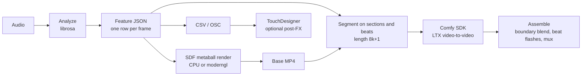

# Xenoform

Higgsfield's Music Video Generator, rebuilt open-source on ComfyUI.

A music video director, not a visualiser.

The default path is open weights only. Stills are Z-Image Turbo, with local FLUX.2 Klein and FLUX.3 Klein optional. LTX-2.3 is the sole core video model, and this entry claims the LTX bonus. LTX 0.9.5 covers morphs, and it is what Turbo and smaller cards load. Turbo never loads LTX-2.3. Prompt encoding uses the local text encoder. Any LTX API key field stays empty. LTX-2.5 partner nodes are not in the default graphs.

Add-ons are off. Settings has an Add-ons switch for FLUX 3 API, H3 API, partner nodes, and cloud LLMs. The demo, the judges page, and setup do not use it. `comfy.addons` defaults to false. CI fails if a default workflow references a partner or API node, fills an LTX API key, encodes prompts through the LTX API, or uses an LTX-2.5 partner node.

Xenoform turns a song into a cut: one action shot per section, hard-cut on the bar, then restyled with ComfyUI. The name stays. It is the form, and it is foreign to the track it grew from.

## Quick start

Three steps. The first cut does not need a GPU, a model, or an account.

1. **Install into Xenoform's own environment.** You need Python 3.12 on `PATH` (python.org installer, tick "Add python.exe to PATH") and `ffmpeg` on `PATH`. On Windows, double-click `install.bat`. It creates `.venv` with Python 3.12, installs the pinned requirements (including `comfy-sdk` 0.5.0 and `comfy-api-proxy` 0.1.6) and the `xenoform` package itself, and does not pip-install into ComfyUI. On Linux or macOS, run `bash install.sh`. Linking the pack into `custom_nodes` is optional: `install.ps1 -LinkNodes` or `bash install.sh --link-nodes`.
2. **Open the desk.** Start ComfyUI on port 8188 first if you want GPU renders. On Windows, double-click `Xenoform.bat`. It starts `comfy-api-proxy` on port 8189 in front of ComfyUI (if it is not already running; log in `xenoform_proxy.log`), starts the server minimised and opens [http://127.0.0.1:47317](http://127.0.0.1:47317). The first screen is Simple mode: a song, then a vibe, then Make. Each step waits for the one before it. Advanced in the header keeps the full desk, including the morph panel, and that choice is remembered. If the desk is already up, it opens the browser and appends a line to `xenoform_duplicate.log` instead of starting a second server. When `configs\local.json` is present, the launcher loads it with `--config configs\local.json` and sets `XENO_ADDONS=0`, so Add-ons stay off. ComfyUI stays on [http://127.0.0.1:8188](http://127.0.0.1:8188). The desk pings `/system_stats` and shows connected or not connected. If you linked the node pack, the same page is also at [http://127.0.0.1:8188/xenoform](http://127.0.0.1:8188/xenoform).
3. **Press Watch a finished one** to see a pre-rendered reel instantly (five LTX morphs cut to the bar; no GPU, plays in under a second). Then pick **Bundled demo**, a vibe, and **Make my video**: a draft animatic plays after about 3 seconds, then the GPU pass replaces it with a chain of A→B liquid morphs, one per scene, handing off on the beat (see *Simple mode GPU pass* below). On a 12 GB RTX 3080 Ti that is about 48 seconds warm for a 20-second, 7-shot clip and about 55 seconds for the first run after ComfyUI starts, with a live countdown that re-estimates from the real morph pace. On the Advanced desk, **Try the demo** The bundled royalty-free track and the Pynchon register render a dry-run draft. If `examples/demo.wav` or `examples/demo_base.mp4` is missing, the first open writes them. Setup can download the fast LTX model later, when you want a live restyle.


Drag `workflows/xenoform_draft.png` or `workflows/xenoform_final.json` onto the ComfyUI canvas and queue it. `workflows/xenoform_morph.json` is a plain API-format A→B object morph (LTX 0.9.5, two `LTXVAddGuide` frames, about 7–9 s for 49 frames at 512×288 on a 3080 Ti): put two stills named `shot-a.png` and `shot-b.png` in `ComfyUI/input` and queue it. The morph graph is also what Simple mode runs for its GPU pass.

### Simple mode GPU pass

Make keeps the 3-second CPU animatic on screen, then submits one morph per scene, all at once, through comfy-sdk → comfy-api-proxy. Morph *i* starts on still *i* and ends on still *i+1*, so the picture never jumps: every handoff is one still, and each handoff is the scene boundary snapped to the nearest beat (within 0.25 s). Each morph is generated at the next 8k+1 length and resampled to its scene's exact frame count with both end frames kept, then the cut is muxed with the song at 768×432 (lanczos from the 512×288 render).

The stills come from `src/xenoform/ui_static/objects/<vibe>/`, eight per vibe, listed in `objects.json`. Five sets are curated library objects (liquid mercury, chrome, iridescent glass, oil-slick, black glass) regraded so each vibe has its own glow and backdrop: Liquid gold is amber on umber, Bloom pink on spring green, Neon night magenta on crimson-black, Ocean aqua on deep teal, Cosmic cobalt on indigo. Paper summer is bright folded paper and porcelain on sunlit cream, made once with Z-Image Turbo (seeds 1000–1007). No retro or sci-fi props. A story noun that names one of a vibe's objects (for example "manta ray" on Ocean) leads the chain. The prompt is one line per vibe, because the two guide stills carry the objects and ComfyUI then encodes it once per run. `XENO_MORPH_SIZE` (for example `640x352`) and `XENO_MORPH_STEPS` override the defaults; 768×432 peaked at 11.9 GB and took about 74 s, so it is not the default. If the GPU pass fails, the animatic stays as the result.

The same draft graph is stored in the PNG `workflow` text chunk, and a short pointer is in the comment of `examples/demo_base.mp4`.

### Judges

Open `/judges` on the desk, or serve `src/xenoform/ui_static` as a static site and open `judges.html`. A judge drops in any song. The browser finds the beats and cuts a pre-rendered shot library to them. Calm is the default, and morphs stay at two or fewer. Nothing on that page calls a GPU. If a client posts to `/api/judges/analyze`, the desk allows six calls a minute from one address and then answers 429.

### Hardware

The desk reads the GPU and picks a preset. If a live render runs out of memory, it drops a tier, retries, and says so in plain words.

| Machine | Preset | Turbo | Draft | Final | Weights |
| --- | --- | --- | --- | --- | --- |
| No GPU | CPU | 384×216 animatic | 512×288, dry run | 640×360, dry run | None required |
| About 8 GB | 8 GB | 384×224, 4 steps | 512×288, 8 steps | 512×288, 12 steps | Offloaded. LTX 0.9.5. Turbo never loads LTX-2.3 |
| About 12 GB | 12 GB | 384×224, 4 steps | 704×384 when an fp8 LTX-2.3 file is present, otherwise 512×288 | 704×384, about 210s a shot, when fp8 is present, otherwise 640×360 | LTX-2.3 fp8 or int8 on Draft and Final. LTX 0.9.5 otherwise. Turbo never loads LTX-2.3 |
| 24 GB and up | 24 GB+ | 384×224, 4 steps, still LTX 0.9.5 | 640×360, LTX-2.3 | 768×432, LTX-2.3 | Action shots use LTX-2.3 image-to-video when that file is installed. Otherwise LTX 0.9.5 |

Live is the same picture on every row: the browser march, including integrated GPUs and a headless SwiftShader smoke test. It does not load a weight.

### Troubleshooting

| What you see | What to do |
| --- | --- |
| The sidebar has no Xenoform tab | Open `http://127.0.0.1:8188/xenoform`. The route is registered with the node pack. Restart ComfyUI after install. |
| Try the demo sits on "Reading the track" | `ffmpeg` needs to be on `PATH`. The installer says so when it is missing. |
| Live restyle says ComfyUI did not answer | Stay on dry run, or point Settings at the Comfy base URL. Dry run needs no weights. |
| A download stops | Press the same Download button. It resumes. A file that fails its checksum is deleted, and the sentence on screen says to run it again. |
| The GPU ran out of memory | Leave the message up. The desk already dropped to a smaller preset and tried again. Close other programs if the 8 GB preset also runs out. |
| Director's notes has no local model | The rule reader still applies the note. Ollama is optional. |
| Copy diagnostics | The button in the header copies a short report. The on-screen error stays one sentence. |

### Comfy Cloud and RunPod

**Comfy Cloud.** Open [cloud.comfy.org](https://cloud.comfy.org), drag in `workflows/xenoform_draft.json`, and queue it once this pack is available there. For the SDK path from this repo, set `COMFY_API_KEY` and switch the desk to Live. The key stays in the environment. The default download path does not ask for a Hugging Face token.

**RunPod.** Start a ComfyUI template, open a terminal in the pod, and run:

```bash
cd /workspace/ComfyUI/custom_nodes
git clone <this project's git URL> xenoform
pip install -r xenoform/requirements.txt
```

Restart the pod's ComfyUI process, then open `/xenoform` on the pod's ComfyUI port.

### Registry publish (a person does this once)

ComfyUI Manager search finds the pack after it is on the [Comfy Registry](https://registry.comfy.org). That needs a publisher account. Put the publisher id in `pyproject.toml` under `[tool.comfy] PublisherId`, set `[project.urls] Repository` to the public git URL (it is a placeholder until then), and run `comfy node publish` with the registry API key. Git-URL install works before that publish.

This is a local Python pipeline for the [Open Source Higgsfield](https://comfy.org/open-source-higgsfield/) competition. It is MIT licensed. Stage 3 uses the official [Comfy Python SDK](https://docs.comfy.org/development/api-development/sdks) (`comfy-sdk` 0.5) against either Comfy Cloud or a self-hosted ComfyUI behind [`comfy-api-proxy`](https://docs.comfy.org/development/comfyui-server/api-proxy). TouchDesigner is an optional listener. Nothing in the core path imports it. Ableton is not required. Demucs is optional; without it, bands come from librosa.



## What works in 0.1

| Stage | Status |
| --- | --- |
| Synthesized test audio | Works. Deterministic, no external assets. |
| Analysis: beats, onsets, RMS, sub/bass/mid/high, sections, drops | Works. Covered by tests. |
| Base-form raymarch | Works on CPU with no GPU. Optional moderngl path falls back to CPU if no GL context. |
| Example base-form mp4 | `examples/demo_base.mp4`, 12 seconds, audio muxed. |
| Chunking to LTX frame counts | Works. |
| LTX restyle | **Works live.** Submission uses the real SDK (`workflows.from_file`, `assets.from_file`, `set_input`, `submit`, `events`, `result`, `get_outputs`) through `comfy-api-proxy`. Verified 19 Oct 2026 on an RTX 3080 Ti: every Simple-mode chunk went `POST /api/v2/assets` → `POST /api/v2/jobs` → SSE events, and the manifest records `submit: sdk`. |
| Simple mode GPU pass | **Works live (morph chain).** Each scene is one `workflows/xenoform_morph.json` morph from still *i* to still *i+1* (LTX 0.9.5, 512×288, 12 steps, 24 fps; T5 on the CPU so the card peaks about 7.8 GB), submitted with comfy-sdk through comfy-api-proxy. Verified 19 Oct 2026 on an RTX 3080 Ti; see `src/xenoform/morph_pass.py`. |
| Assemble, crossfade, beat flashes, audio mux | Works. |
| OSC / CSV for TouchDesigner | Export works. Streaming needs `pip install python-osc`. |
| Director desk (`xenoform ui`) | Works in the browser. Dry-run generate is the default. Live generate needs a Comfy endpoint. |

## Install from a checkout

The path above is the one to hand to someone else. From this checkout, Python 3.10+ and `ffmpeg` on `PATH`:

```bash
python -m venv .venv
source .venv/bin/activate
pip install -r requirements.txt
pip install -e ".[dev]"
```

Optional:

```bash
pip install -e ".[gpu]"   # moderngl base-form renderer
pip install -e ".[osc]"   # live OSC stream
```

## Quickstart

The committed demo was rendered with `configs/demo.json` (640×360, 24 fps, 12 s). Regenerate it:

```bash
xenoform synth --config configs/demo.json --out examples/demo.wav
xenoform analyze examples/demo.wav --config configs/demo.json --out examples/demo_features.json
xenoform render --config configs/demo.json \
  --features examples/demo_features.json \
  --audio examples/demo.wav \
  --out examples/demo_base.mp4
```

Full pipeline, stage 3 in dry-run (no ComfyUI). The final mp4 is the base form, cut on the analysis grid, boundary-blended, with beat flashes and the original audio:

```bash
xenoform run --config configs/example.json --synth --out work/xenoform.mp4
```

Stop after the beauty pass:

```bash
xenoform run --config configs/example.json --audio examples/demo.wav --base-only --out work/base.mp4
```

## Directing

Xenoform is a music-video director. The default pipeline is shots: one action per scene card, cut on the bar.

`xenoform ui` opens on **Simple**, on Live, at [http://127.0.0.1:47317](http://127.0.0.1:47317). One line — for example `A lighthouse keeper and a fox wait out the storm` — plus a register, plus Play. Record writes the browser picture. Generate is for Turbo, Draft, and Final. With no local LLM, the planner still reads the brief: one hero, one prop, one place, then one shot per section. The register's forms are the look. They do not replace the people in the brief. Set `XENO_LLM_URL` to a local HTTP endpoint if you want a model to rewrite the cards. No API key is required.

### Shots, not morphs

Each card is a genuine action shot. The model sees the first frame as a guide and plays the verb. LTX-2.3 is the sole core video model for action shots on Draft and Final when that file is installed. A 24 GB card can load the full distilled weights. A 12 GB card loads an fp8 or int8 file, at 704×384, about 210 seconds a shot. LTX 0.9.5 covers morphs, and it is the required download: Turbo always uses it, and so does a 12 GB card that has no quantised LTX-2.3 file. Wan 2.2 TI2V (or the heavier I2V pair) stays an optional open-weights alternative. Set `comfy.video_model` to `wan` to ask for it. Turbo never loads Wan or LTX-2.3. Setup matches fp8, int8, and other quantised filenames, and the model card lets you pick the file.

The edit is a hard cut on the beat or the bar. Shot grammar is wide, medium, close, and reveal, each with a camera move. A keyframe-to-keyframe morph is a signature transition, used once or twice in a video, usually on the drop. Liquid metal is an optional Look. The desk default is Action Cut.

**Director** is the storyboard. One scene card per song section:

| Field | What it decides |
| --- | --- |
| Protagonist, goal, payoff | The spine of the video. The same three lines sit on every card |
| Action | A literal line. `the rocket is born, cold and paranoid` |
| Verb | The action the shot plays. `is born`, `climbs`, `hits`, `lands` |
| Subject | What is in the frame for this card |
| Shot | wide, medium, close, reveal, plus macro, overhead, tracking |
| Camera | push in, pull back, orbit, follow, hold |
| Edit | Hard cut by default. A signature morph comes from the register's drop |
| Mood and light | dawn, neon, storm, cold, forge, night, marble, void |
| Duration | Snapped to bars of the detected tempo |

Story beats map setup / rising / climax / release onto the intro, the build, the drop, and the outro. The first card is a wide shot, the rise is a medium, the climax is a close-up, and the last card is a reveal. The climax starts on the loudest drop. Drag the Climax chip onto another card to move it. Mark a motif and that form returns. A callback (`the sphere returns at the end, changed`) is the last line.

The cards compile into the render: each one writes the restyle prompt, the camera and lens, and the cut. Registers still seed the board — Pynchon, le Carré, Tolkien, Rome, or Custom. Looks, the dice (it rolls several cheap boards and keeps the best), and the recipe code stay. The code now carries the storyboard.

The waveform sits under the board. The picture sits beside **Director's notes**.

Before any picture, the desk shows the beat grid and the section map. Lyric align is off. Turn it on to shift a local transcript later by 0.3–1.5s, because Whisper timestamps land early. That step does not call a cloud model.

Each shot on the review desk shows its keyframe beside the clip, with the prompt and Remake. The same seed repeats a take. A new seed keeps the old ones. A text-only change re-renders that shot. A full batch waits until one or two of those shots are marked as test clips.

A treatment is one line, a through-line, one lead sentence, and a colour rule. The lead sentence is inserted into every shot prompt. Titles and lyrics are drawn onto the picture in code, with a dark band under the words, and they are kept off faces.

The story step keeps a continuity bible. Cast lock gives the hero one sentence and one reference still. The same rule covers the key prop, the place, the time of day, and the weather. That sentence goes into every shot prompt where the element appears, and the still is the guide. The piece has one of each, unless the story asks for more. Before a render, every shot has to follow from the one before it, and the whole piece has to fit in one sentence a stranger would get. After a render, Review & fix compares those stills locally and re-renders only the shots that drift.

**Share cut** writes a 720p H.264 file under 16MB.

## Director's notes

Generate a fast draft, watch it, then write one plain-English note. Examples that the desk already understands:

- `the ending plops, make it a big splash`
- `scene 3 too dark`
- `bolt should strike on the beat`

A local model turns the note into a patch. Ollama is the default, at `http://127.0.0.1:11434`, model `qwen2.5:7b-instruct` (override with `XENO_LLM_MODEL`, host with `XENO_OLLAMA_URL`). Set `XENO_LLM_BACKEND=openai` and `XENO_NOTES_LLM_URL` to a local OpenAI-compatible `/v1` base when another server on the machine should read the note. No cloud key is required. When Ollama is down, a rule reader handles the same notes so the desk still answers.

The storyboard rewriter is a separate hook: `XENO_LLM_URL` still receives `{brief, register, scenes}` for that pass only.

Before any video job, including Generate and a confirmed note, the desk calls Ollama `keep_alive: 0` so the model leaves a 12GB GPU for ComfyUI.

The interpreter is grounded with the current storyboard, the beat grid, and the recipe catalogue: snap, ribbon, pour-harden, droplet-burst, droplet-gather, spike-burst, grow-out, dive-splash, fly-through, bolt-strike hold, swim hold. The patch is JSON:

```json
{
  "target_scenes": ["s6"],
  "changes": [{"scene": "s6", "field": "edit", "old": "dissolve", "new": "dive-splash"}],
  "transition_type": "dive-splash",
  "speed": null,
  "retime": null,
  "guide_strengths": null,
  "recipe": null,
  "rerender": ["s6"],
  "rationale": "The landing should hit as a dive-splash."
}
```

The patch is checked against that shape. Unknown recipes are rejected. The panel then shows a human diff — `Scene 07 · edit: dissolve → dive-splash` — with Confirm and Undo. Nothing renders until you confirm.

**Critic.** Optional. It samples the draft and runs heuristic checks: frozen frames, hard cuts, and motion peaks from the beatlock detectors, off-beat key moments, exposure blowout, and a Harding-style flash count (more than 3 opposing flashes in one second). These are heuristics, not a certification. Set `XENO_VLM_MODEL` (for example `qwen2.5vl`) to add one short qualitative line from a local vision model. Suggestions show up as chips. One click fills the note and opens the diff.

The same pass reads `docs/LESSONS.md`. Slow-motion into an impact is flagged as an anticlimax, and the beat lock trims into the hit. Dissolves cap at 8 frames. Bolt guides cap at 0.30, other guides at 0.40, and end guides sit 32 frames later. A wavy shimmer look is not a preset. Frozen frames and a still climax point at dive-splash or droplet-burst.

**Lessons.** When a note fixes a problem the critic already raises, the panel offers to save it. Saved lessons go to `lessons.json` and a new row on `docs/LESSONS.md`. The next cut's critic suggests that note again while the board still has the old problem. Typing the note again replays the saved patch, retargeting an ending onto whatever card is last.

**Versions.** Every confirmed note stores a version: the storyboard, the patch, and the segment paths. The list under the patch can flip between two cuts, or revert. Revert appends a new version so the timeline stays.

**Selective re-render.** A segment cache key is `(scene card hash, seed, model, resolution)`. The seed stays `2727`. Live is `live@preview`, the browser picture. Turbo is `ltx-095@384x224` (the animatic is `animatic@384x216`). Draft is `checkpoint@512x288`. Final is `checkpoint@640x360`, which misses the whole cache and renders full resolution. A note reruns only the segments whose key changed. Beat-lock retimes are stored in seconds on the scene and stamped onto the source frames (`retime.anchors_s`), then expanded with `anchors_at_fps` so the same map lands on the final frame grid. Changing a card while a cut is rendering cancels that job.

On a dry desk the rerun writes a segment manifest (the card, the seed, the retime) and keeps the picture you are already watching. Point a later beauty pass at those manifests. `release_llm()` still runs first.

The Notes view is `#notes`. The same panel sits beside the player on the storyboard.

## Connect an AI

The desk is also an MCP server, so Grok, Claude, GPT, Cursor, or any other MCP client can direct the cut. The server is off until you start it. It binds to localhost only. There is no token.

Stdio is the path for Claude Desktop and Cursor. From the repo, with the desk already open:

```bash
xenoform mcp
```

`XENO_DESK` is the desk the tools call. It defaults to `http://127.0.0.1:47317`. The Connect panel in the app fills the snippet with the desk you actually have open.

Claude Desktop, `claude_desktop_config.json`:

```json
{
  "mcpServers": {
    "xenoform": {
      "command": "xenoform",
      "args": ["mcp"],
      "env": { "XENO_DESK": "http://127.0.0.1:47317" }
    }
  }
}
```

Cursor, `.cursor/mcp.json`, is the same block. A generic client that speaks streamable HTTP uses a second port, which stays closed until you press **Start on this machine** or run:

```bash
xenoform mcp --http --host 127.0.0.1 --port 47319 --desk http://127.0.0.1:47317
```

```json
{
  "mcpServers": {
    "xenoform": { "url": "http://127.0.0.1:47319/mcp" }
  }
}
```

Any other host is refused. The optional extra is `pip install 'xenoform[agent]'` (`mcp>=1.8`). The desk itself runs without it. If the extra is missing, `xenoform mcp` says so and exits.

Tools: `list_registers`, `get_register`, `set_register`, `list_presets`, `set_preset`, `analyse_track`, `create_storyboard`, `edit_scene_card`, `set_params`, `apply_note`, `run_review`, `render` (`live`, `turbo`, `draft`, `final`, optional scene ids), `get_render_status`, `get_frames`, `list_versions`, `revert`, `export`. Resources: `xenoform://storyboard`, `xenoform://lessons`, `xenoform://transitions`.

The tools call the same local REST API the browser uses. **Test connection** on the Connect panel asks the desk whether port 47319 is answering. It does not send a secret.

| Method | Path | What it does |
| --- | --- | --- |
| GET | `/api/v1/health` | Desk is up. No auth. |
| GET, POST | `/api/v1/session` | Current board. The UI writes `source: ui`. An agent write uses `source: agent`. |
| GET | `/api/v1/registers`, `/api/v1/registers/{id}` | Registers. |
| POST | `/api/v1/register` | Switch voice and rebuild the board. |
| GET | `/api/v1/presets` | Named looks. |
| POST | `/api/v1/preset` | Apply a look. |
| POST | `/api/v1/analyze` | Analyse a local audio path. |
| POST | `/api/v1/storyboard` | `brief` plus optional `register`. |
| POST | `/api/v1/scenes/{index}` | Edit one card. |
| POST | `/api/v1/params` | Tier, palette, flash, faders. |
| POST | `/api/v1/notes` | Apply a director's note. |
| POST | `/api/v1/review` | Audit. Body may include the board the UI is showing. |
| POST | `/api/v1/review/apply` | Write the fixes. Versions the before and after. |
| POST | `/api/v1/render` | `tier` and optional `scenes`. Live does not start a model. |
| GET | `/api/v1/render/{job_id}` | Job status. |
| GET | `/api/v1/frames`, `/api/v1/frames.png` | Contact sheet. |
| GET | `/api/v1/versions` | Storyboard versions. |
| POST | `/api/v1/revert` | `version_id`. |
| POST | `/api/v1/export` | Recipe code. |
| GET | `/api/v1/lessons`, `/api/v1/transitions` | Lessons and the transition catalogue. |
| GET | `/api/v1/mcp/status` | Is 47319 answering. |
| POST | `/api/v1/mcp/start` | Start the localhost HTTP agent port. |

```bash
xenoform ui --host 127.0.0.1 --port 47317
```

The morph source library is a folder of `library.json` plus media. The 500 MB pack is not in the repo. Settings → Library folder defaults to `./library`. Missing files and unknown categories stay in the index. Faces are excluded unless you clear that box. PD-US only items stay out unless US use is on. A render writes CC BY lines to `CREDITS.md` beside the mp4.

```bash
python scripts/fetch_sample_library.py
```

That writes a few procedural shapes. Point Settings at the full pack when you have it. Advanced → Morph browses the index, filters by tag, and pins or bans an item.

Open `http://127.0.0.1:47317`. On Windows, `Xenoform.bat` does that and opens the browser. Inside ComfyUI, after `install.ps1 -LinkNodes`, the same desk is at `/xenoform`. The desk loads `examples/demo_base.mp4` and `examples/demo_features.json`, and writes them on first open if they are missing, so the screen is full with no GPU.

The recipe still stores the older block script too: a form, a hold, and the transition (`pour-harden`, `droplet-burst`, `ribbon`, `snap`, `grow-out`).

The headline of the desk is the register: a story voice. Pynchon (the Gravity's Rainbow pack: V-2, Byron the Bulb, octopus, Tower, scream; cold violet; droplet-burst on the drop), le Carré (dead drop, streetlamp, typewriter, briefcase; grey-green; slow pour-harden and no beat flash), Tolkien (ring, forge, tree, mountain; molten gold; a slow grow-out), Rome (coin, bust, legion standard, lion; marble and bronze; hard snaps on the drop), and Custom, built from nouns and photos you add. Picking one fills the timeline, the forms, the transitions, the faders, and two original on-screen lines (the drop and the outro). Those lines are written for this desk. Nothing is quoted from the books. Every field stays editable. The register, its lock, and the lines travel inside the recipe code. The dice rolls the storyboard of the register you have picked, unless the storyboard lock is on.

A noun or a photo adds a form. Those cards are the subject in the frame. On a generated cut, the two register lines are burned onto the picture. The reference player keeps showing `examples/demo_base.mp4` until you generate. Live stays a raymarched picture in the browser, on the beat, with nothing to install.

Looks are ten named mixes. Action Cut is the default. Liquid Metal is optional. The dice rolls several storyboards and keeps the best one. The recipe code (`XF-` groups of four) restores the faders, the locks, the brief, and the scene cards, including the protagonist, the verb, and which card is the signature. Photos are not stored in the code.

## Review & fix

**Review & fix** sits in the header, next to Generate. It audits the storyboard you are looking at, and the current picture when that picture is a render from this desk. It does not need a language model. A local model can add one extra line when `XENO_REVIEW_LLM=1` and Ollama answers. Otherwise the report is the rules only.

The checks: frozen frames and a still standing in for a hit, a low-motion hold, a morph-heavy cut, a missing protagonist or a missing setup / climax / release, a hard cut landing inside a morph that was not marked as a signature, key moments off the beat, slow-motion into an impact, two accents stacked on one hit, a dissolve longer than 8 frames, blown-out frames and crushed blacks, a Harding-style flash faster than 3 a second, a straight-line hold, a seam on a segment overlap, audio and picture lengths that disagree, a loop of the same form, no hook in the first 20 seconds, and a cut rhythm outside about 3.5–6.5 seconds. The same pass reads every rule in `docs/LESSONS.md`.

Each row says what it found, in one sentence, with the before and the after. A **board fix** is free: retime and beat-lock, a trim, a dissolve cap, an accent taken off, the flash gate, a grade clamp. **Needs a picture** names the scenes whose edit, form, or camera changed. **Apply all fixes** writes every row. **Fix the biggest** writes only the top row the board can change. On Live the canvas updates immediately. On Turbo, Draft, or Final the desk queues a render of those scene ids in the tier you already have selected. Turbo still paints the whole animatic, and unchanged cards come from the keyframe cache. Undo restores the version stored just before the apply.

### How Review works

Review is two passes that share one report.

The fresh-eyes pass never sees the storyboard, the prompts, or the guide strengths. It samples the rendered picture itself, every 0.2 seconds, and again in a tighter grid around each cut. It returns ranked problems with timestamps and a verdict: **ship** or **one more pass**. Ship means every measured bar item passed and the list is empty. A meter that could not run is left unmeasured. It does not fail the cut. The loop is: fix the biggest problem, re-render, and the next pass rechecks the items it raised before.

The sound-off test is a silent contact sheet at 2 frames a second. The critic retells the story from the brightness and the motion. If that retelling does not hold, the report says **story unclear**.

The measured bar is pass or fail: exact duration, size, and frame rate for the tier; frame 1 is a finished picture; no still stretch longer than half a second, and under a second of frozen picture in every thirty; every cut and hit within one frame of a beat; loudness about -14 LUFS, true peak at or under -1 dBTP, no clipping; on-screen text at 4.5:1 and inside the safe margins; the Harding flash gate.

Every round appends its before and after measurements to `ledger.md` and `ledger.json` under the desk's work folder. The version panel shows that ledger.

The planner pitches two or three treatments before any full render. Each treatment names three signature moments. You pick one, or the desk picks: a brief with an origin and a destination takes **The life**, and anything else takes **The cut**. The pick is followed by a style bible — palette, look, motion rules, textures — and three style frames. Turbo then plays a 3–5 second proof, end to end, before the real animatic.

Audio is the clock. The picture is cut to it. The music is not stretched, sped, or bent. `timing.json` lists the beats, the drops, and the key actions, and the animation reads those times back. **Music only** exports the song with the picture left out.

The same report checks the craft of the board: one subject carries the film; a hard cut is motivated by what is on screen and lands on a beat at a matching size and direction; one lead movement has a follow-through; scale changes (macro, wide, overhead, full frame) and a layout is not repeated; an effect earns its place, so decorative particles and a generic glitch are flagged; a camera move follows something in the shot.

Every varying number is a function of the frame index and the seed. The same seed and the same frame render the same picture.

The quality switch is Live / Turbo / Draft / Final, and each one shows an ETA before you render. Live is the picture in the browser: a raymarched liquid body on the beat, on any GPU, with nothing to install. Play stays in time with the song. A slider, a palette, or a scene card lands on the next frame. Record writes an mp4 with no model, and that file can guide Turbo, Draft, and Final. Turbo plays an animatic first: one 384px keyframe a scene, hard-cut on the bar, with a crossfade only on the signature. On a 12 GB GPU the follow-up is LTX 0.9.5 at 384×224 in 4 steps, about a minute the first time and a few seconds when a scene is already cached. Turbo never loads Wan or LTX-2.3. Draft and Final action shots default to LTX-2.3 image-to-video when that file is installed: the full weights on a 24 GB card, and an fp8 or int8 file on a 12 GB card at 704×384. Otherwise they use LTX 0.9.5. Wan 2.2 is an optional alternative. Draft is 512×288 at 12 fps. Final is 640×360 at 24 fps, or 704×384 when the 12 GB card is on LTX-2.3 fp8. Fill to 24 fps is optional and uses ffmpeg. The same seed and the same retime in seconds carry across. Dry run is the default. Settings can point the Comfy endpoint at the base URL in `configs/example.json` (the proxy on port 8189, unless you change it). Each finished scene shows up in the player while the rest is still rendering, and the desk stays editable. Live+AI (StreamDiffusion) and TensorRT are optional checks on Setup. If they are missing, Live keeps playing and the regular checkpoint stays in use.

Band map: kick drives the morph impulse, bass the camera push, hats the flicker (specular, not a post shimmer), vocals the surface. Globals are liquidity, chaos, material, and camera energy.

Tests:

```bash
pytest
```

## Config

`configs/example.json` is the documented config. Omitted keys fall back to the same defaults in `xenoform.config`.

| Key | Role |
| --- | --- |
| `fps` | Analysis and base-render frame rate. LTX conditioning and `CreateVideo` use this too. The shipped demo is 24. |
| `render.backend` | `cpu`, `gpu`, or `auto`. `auto` and `gpu` try moderngl, then the CPU marcher. |
| `render.width` / `height` | Beauty pass. Even numbers, so yuv420 encoding works. |
| `render.write_depth` / `write_mask` | Extra mp4s next to the beauty pass. |
| `segment.*` | Target chunk length. Cuts prefer section boundaries, then beats. Each chunk's frame count is snapped to `8*k+1`. |
| `prompts.*` | One prompt per section label: `calm`, `build`, `drop`, `release`, `sustain`, plus `negative`. |
| `comfy.mode` | `dry-run` (default) or `live`. `--live` / `--dry-run` override it. |
| `comfy.workflow` | API-format graph. Default `workflows/ltx_v2v_api.json`. |
| `comfy.nodes` | Node ids the runner writes. Point these at your own export if you swap the graph. |
| `comfy.width` / `height` | Latent size. **Multiples of 32.** 512×320 is the 12 GB starting point. |
| `comfy.checkpoint_name` / `clip_name` | Filenames as they appear in the ComfyUI model dropdowns, not paths. The desk uses the LTX-2.3 file you pick. On 12 GB that file has to be fp8 or int8. `ltx-2.3-22b-distilled-fp8.safetensors` counts. |
| `comfy.video_model` | `ltx` (default), `ltx-23`, `ltx-095`, or `wan`. `wan` asks for the optional Wan 2.2 alternative. Turbo ignores this and stays on LTX 0.9.5. |
| `comfy.addons` | Off by default. FLUX 3 API, H3 API, partner nodes, and cloud LLMs stay behind this switch. The demo, the judges page, and setup do not read it. |
| `assemble.beat_flashes` | Short lift on analyzer beats. Off if you want the restyle untouched. |
| `osc.host` / `port` | Where `xenoform osc --stream` sends UDP. |

## How the picture is driven

Per frame, at `fps`:

* **Sub + bass** scale the body. Bass is the swell.
* **Mids** spin the arrangement.
* **Highs** raise surface-noise frequency and the specular.
* **Onsets** throw tendrils. The spike decays (`analyze.onset_tau`).
* **Drops** lerp the metaball layout into a second, more broken arrangement and push the LTX denoise up.

Section labels come from the slope and level of smoothed energy. The loudest span is marked `drop` when it sits above the track. Prompts change with that label. Inside a chunk, mean energy becomes a denoise value:

* `preserve_strength = 1 - denoise`, written to `LTXVImgToVideoInplace.strength`
* In ComfyUI that strength is a **preserve** control: `1` keeps the encoded frames, `0` lets the sampler replace them
* `img_compression` on `LTXVPreprocess` rises with the same denoise, so drops are grittier

A calm section stays close to the chrome render. A drop is allowed to mutate.

## Stage 3: LTX video-to-video

Two API-format graphs ship in `workflows/`. Both are core ComfyUI nodes only. Node ids match `configs/example.json`, so either file works without editing the node map.

**`workflows/ltx_v2v_api.json` (default).** Frame-aligned restyle.

`LoadVideo` → `GetVideoComponents` → `LTXVPreprocess` → `LTXVImgToVideoInplace` over an `EmptyLTXVLatentVideo`, sampled with `LTXVScheduler` + `ModelSamplingLTXV` + `CFGGuider` + `SamplerCustomAdvanced`, then `VAEDecode` → `CreateVideo` → `SaveVideo`. The checkpoint is `CheckpointLoaderSimple`. The text encoder is a separate `CLIPLoader` with `"type": "ltxv"`, which is how ComfyUI runs LTX-Video 0.9.5.

**`workflows/ltx_v2v_guide_api.json`.** The same graph, but node `10` is `LTXVAddGuide` and node `16` is `LTXVCropGuides`. This is the official multi-frame guide path: the chunk is a reference, not a partially noised latent. Use it when you want the model to follow the body more loosely. Set:

```json
"workflow": "workflows/ltx_v2v_guide_api.json"
```

`strength` on `LTXVAddGuide` is not the same knob as inplace preserve-strength (the guide node allows values above 1). Start from the dry-run manifest and retune.

The runner talks to Comfy the way the SDK documents, and only that way:

```python
from comfy_sdk import Comfy

client = Comfy(client_info="xenoform")          # key from COMFY_API_KEY when send_api_key is true
wf = client.workflows.from_file(workflow_path)  # API-format graph
asset = client.assets.from_file(chunk_path)     # lazy, content-addressed
wf.set_input("6", "file", asset)
wf.set_input("3", "text", prompt)
job = client.submit(wf, idempotency_key=key)
for event in job.events():
    ...                                          # Progress, StatusChange
result = job.result()                            # raises JobFailed with node detail
result.get_outputs("19")[0].to_file(dest)
```

`COMFY_BASE_URL` is set from `comfy.proxy_url` for the client constructor. There is no base-url argument on `Comfy()` in 0.5. `comfy.base_url` stays the ComfyUI health address (`http://127.0.0.1:8188`, `/system_stats`). Live submits go to the proxy on port 8189. A local proxy does not receive `COMFY_API_KEY`. Comfy Cloud is an empty `base_url`, an empty `proxy_url`, and `send_api_key` true.

Submits are not retried in a loop. Each chunk gets one idempotency key, stored with the job id in `work/chunks/comfy_state.json` as soon as `submit` returns. On `IdempotencyKeyReuse` the runner loads that id with `client.jobs.get` and does not submit again. The v2 contract rejects a reused key; it does not replay the first job.

Labels (`metadata`) are not sent. Comfy Cloud and `comfy-api-proxy` both refuse a label map on submit.

### What you need for a local 12 GB RTX 3080 Ti

LTX stays first. Draft and Final on this card use **LTX-2.3 22B distilled fp8** when that file is in `models/checkpoints`, at 704×384, about 210 seconds a shot. The full unquantised weights stay on a 24 GB card. With no fp8 or int8 file, the graph uses **LTX-Video 2B 0.9.5**. Turbo always uses 0.9.5. Z-Image Turbo stills match `z_image_turbo_bf16` and quantised names such as `z_image_turbo_int8_convrot`. If it OOMs, the desk drops a tier and says so. The checkpoint name, the CLIP name, and the workflow path stay config.

1. Install current ComfyUI and start it on port 8188. The desk's default address is `http://127.0.0.1:8188`, and it pings `/system_stats`.
2. Download the checkpoint into `ComfyUI/models/checkpoints/`:
   * [ltx-video-2b-v0.9.5.safetensors](https://huggingface.co/Lightricks/LTX-Video/resolve/main/ltx-video-2b-v0.9.5.safetensors) (about 6.3 GB)
3. Download a T5-XXL encoder into `ComfyUI/models/text_encoders/`:
   * 12 GB machines: [t5xxl_fp8_e4m3fn_scaled.safetensors](https://huggingface.co/comfyanonymous/flux_text_encoders/resolve/main/t5xxl_fp8_e4m3fn_scaled.safetensors)
   * More VRAM: [t5xxl_fp16.safetensors](https://huggingface.co/comfyanonymous/flux_text_encoders/resolve/main/t5xxl_fp16.safetensors), and set `comfy.clip_name` to match
4. Live renders go through `comfy-sdk` 0.5.0 and `comfy-api-proxy` 0.1.6, which `pip install -r requirements.txt` already pins. Start ComfyUI on 8188, then the proxy in front of it:

   ```bash
   .venv\Scripts\comfy-api-proxy.exe --comfyui http://127.0.0.1:8188 --port 8189   # Windows; Xenoform.bat does this for you
   .venv/bin/comfy-api-proxy --comfyui http://127.0.0.1:8188 --port 8189            # Linux / macOS
   ```

   The proxy binds to loopback and does not require a token. See the [API proxy docs](https://docs.comfy.org/development/comfyui-server/api-proxy) and the [SDK docs](https://docs.comfy.org/development/api-development/sdks). `configs/example.json` sets `comfy.base_url` to `http://127.0.0.1:8188` (the health ping) and `comfy.proxy_url` to `http://127.0.0.1:8189` (what the SDK submits to). `send_api_key` stays false. You do not need `COMFY_API_KEY` for this local path. Dry-run does not start the proxy. With the proxy up, live submits use `/api/v2/assets`. Stock ComfyUI answers that route with 405, and the desk then uploads the chunk with `POST /upload/image` and queues it with `POST /prompt` on port 8188. No API key is sent on that path. Simple mode's Make button runs the morph-chain GPU pass when `/system_stats` answers, and keeps the CPU animatic on screen as the preview and as the fallback if the GPU pass fails.
5. Run Xenoform against it:

   ```bash
   xenoform run --config configs/example.json \
     --audio examples/demo.wav \
     --live \
     --out work/xenoform.mp4
   ```

   Settings can switch the live sampler to LTX-2.5. The three graphs are `workflows/ltx25_a2v_api.json` (audio-to-video), `workflows/ltx25_multishot_api.json`, and `workflows/ltx25_layout_api.json` (Layout-to-Render IC-LoRA for a beat-landed morph). LTX-2.3 stays the fallback when the distilled file is missing or the open-weights check fails. Setup does not download the LTX-2.5 files (`ltx-2.5-22b-distilled-transformer-comfy-int8-convrot.safetensors`, `gemma4-12b-with-proj-ltx-2.5-comfy-int8-convrot.safetensors`, `ltx-2.5-audio-vae-bf16.safetensors`); without them the three LTX-2.5 graphs fail ComfyUI validation and the desk stays on LTX-2.3. Turbo stays on LTX 0.9.5. Slot names follow the public LTX node list. If the installed pack rejects a slot, re-export with File → Export Workflow (API) and keep the same node ids.

If `SaveVideo` rejects `format` / `codec` on your build, open the workflow in ComfyUI, export **File → Export Workflow (API)**, and point `comfy.workflow` at that file. Update `comfy.nodes` only if the node ids moved. The runner checks that every configured id exists and that links point at nodes in the graph before it submits.

### Comfy Cloud instead of a local GPU

```json
"comfy": {
  "mode": "live",
  "base_url": "",
  "proxy_url": "",
  "send_api_key": true
}
```

```bash
export COMFY_API_KEY=comfyui-...
xenoform run --config configs/example.json --audio examples/demo.wav --live --out work/xenoform.mp4
```

An empty `base_url` leaves the SDK on `https://cloud.comfy.org`. Cloud API access needs a paid plan. The checkpoint and T5 files still have to exist in that environment under the configured filenames; a cloud deployment that does not contain `ltx-video-2b-v0.9.5.safetensors` will fail the job, which `JobFailed` reports. Partner-node workflows are not the default graph. If you add one, set `comfy.partner_api_key_env` to the env var that holds the key. That value is sent only as `submit(..., api_key=...)`, which the SDK forwards as `extra_data.api_key_comfy_org`. It is not written to logs.

This entry claims the LTX bonus: LTX-2.3 is the core sampler, LTX-2.5 is the optional local upgrade (audio-to-video, multi-shot, and Layout-to-Render), and LTX 0.9.5 covers morphs. The default graphs stay on a local text encoder. Leave any LTX API key field empty. Do not point the runner at an LTX-2.5 partner node (`LtxApi25TextToVideo`, `LtxApi25ImageToVideo`, `LtxApi25AudioToVideo`) or at `GemmaAPITextEncode`.

## Assemble

Chunks are concatenated in order. Padding frames that existed only to satisfy `8*k+1` are dropped, so the result lines up with the feature timeline and the original audio. A short in-place blend mixes frames across each cut without changing duration. Optional beat flashes lift frames whose `beat_env` is hot. ffmpeg muxes the source audio as AAC.

## TouchDesigner

Not required. From a feature file:

```bash
xenoform osc examples/demo_features.json --out work/touchdesigner
xenoform osc examples/demo_features.json --stream --host 127.0.0.1 --port 7000
```

The export directory holds:

* `features.json` — full analysis
* `frames.csv` — one row per frame, easy to drop on a Table DAT or a file-in CHOP
* `osc_addresses.json` — the address list

Streaming sends, per frame, at the analysis fps unless you pass `--fast`:

| Address | Value |
| --- | --- |
| `/xenoform/frame` | frame index |
| `/xenoform/section` | `calm`, `build`, `drop`, `release`, or `sustain` |
| `/xenoform/fps` | once, up front |
| `/xenoform/rms` `/xenoform/sub` `/xenoform/bass` `/xenoform/mid` `/xenoform/high` | 0–1 |
| `/xenoform/onset_env` `/xenoform/beat_env` `/xenoform/energy` `/xenoform/mutate` | 0–1 |
| `/xenoform/is_onset` `/xenoform/is_beat` `/xenoform/is_drop` | 0 or 1 |

In TouchDesigner, an OSC In CHOP on port 7000 receives the float channels. The stream is a clock, not a video transport: press play on the movie and start `xenoform osc --stream` together, or drive a Timer CHOP from `frames.csv` if you need a scrubbable lock.

## Layout

```
configs/example.json          documented config
configs/demo.json             the 12s beauty-pass settings used for examples/
workflows/ltx_v2v_api.json    default LTX video-to-video graph
workflows/ltx_v2v_guide_api.json
src/xenoform/                 synth, analyze, render, restyle, assemble, osc, director desk
examples/demo_base.mp4        committed base-form render
tests/                        analysis, chunking, workflow, dry-run, assemble
```

## License

MIT. See [LICENSE](LICENSE).

Model weights, the two desk fonts, and the pictures are not covered by that MIT grant. The badge says "Open weights" and links to [docs/LICENCES.md](docs/LICENCES.md), which the desk also serves at `/licences`.

LTX-2.3 is under the LTX-2 Community License: free commercial use under about $10M annual revenue, and a paid licence above that, through 11 August 2026. FLUX.2 Klein 9B is non-commercial. The desk's optional Klein file is the Apache 2.0 4B, `flux-2-klein-4b-fp8.safetensors`. Picture credits are in [CREDITS.md](CREDITS.md) and at `/credits`. Anything without a checked author is TODO. The font copyright lines are in [src/xenoform/ui_static/fonts/OFL.txt](src/xenoform/ui_static/fonts/OFL.txt).
